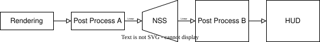
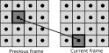

# Neural Super Sampling

## Dataset capture

NSS capture configuration, lifetime, synchronization, dataset layout, and
replay constraints are documented in the [Dataset Capture guide](../Capture/Capture.md).

Neural Super Sampling (NSS) is a temporal frame upscaling technique that improves visual fidelity by reconstructing high-resolution frames from lower-resolution inputs using a neural network running on the Arm Neural Engine.

The model is published by Arm on [Hugging Face](https://huggingface.co/Arm/neural-super-sampling).

## Table of Contents

- [Neural Super Sampling](#neural-super-sampling)
  - [Table of Contents](#table-of-contents)
  - [Platform Support](#platform-support)
  - [Integration Guidelines](#integration-guidelines)
    - [NSS Passes](#nss-passes)
    - [Quality Presets](#quality-presets)
    - [Upscaling Ratios](#upscaling-ratios)
      - [Dynamic offset LUT path for non-2x ratios](#dynamic-offset-lut-path-for-non-2x-ratios)
      - [Non-2x performance guidance (input/output size planning)](#non-2x-performance-guidance-inputoutput-size-planning)
    - [Shader Variants and Extensions](#shader-variants-and-extensions)
    - [Placement in the frame](#placement-in-the-frame)
    - [Input Resources](#input-resources)
    - [Providing color and history](#providing-color-and-history)
    - [Providing depth buffer](#providing-depth-buffer)
      - [Validation](#validation)
    - [Providing Motion Vectors](#providing-motion-vectors)
      - [Space](#space)
      - [Validation](#validation-1)
    - [Providing exposure value](#providing-exposure-value)
      - [Validation](#validation-2)
    - [Providing jitterOffset](#providing-jitteroffset)
      - [Coordinate space](#coordinate-space)
      - [Jitter sequence quality and phase count](#jitter-sequence-quality-and-phase-count)
      - [Validation](#validation-3)
    - [Offline dataset integration diagnostics](#offline-dataset-integration-diagnostics)
    - [Debug View Tile Reference](#debug-view-tile-reference)
    - [Troubleshooting](#troubleshooting)
    - [Header Files](#header-files)
    - [API Interface](#api-interface)
      - [ffxCreateContext](#ffxcreatecontext)
      - [ffxQuery](#ffxquery)
      - [ffxDispatch](#ffxdispatch)
    - [Runtime logging](#runtime-logging)
    - [Lifetime and synchronization](#lifetime-and-synchronization)
  - [Limitations](#limitations)
  - [Known issues](#known-issues)
  - [Integration Checklist](#integration-checklist)

---

## Platform Support

Windows 11 x64.

Linux x64.

Android. (Validated on Android 16)

## Integration Guidelines

### NSS Passes

NSS executes a fixed pass sequence per dispatch:

1. `DepthScatter`
2. `DisocclusionMask` (Balanced/Performance only)
3. `Preprocess`
4. `DataGraph`
5. `GenerateOffsetLut` (non-2x ratios only)
6. `Postprocess`
7. `DebugView` (optional)

The table below summarizes each pass size, what it does, and when it is used.

| Pass | Size | What it does | When it runs / backend selection |
|------|----------------|---------------|----------------------------------|
| `DepthScatter` | `depthScatterSize = renderSize / 2` (**Quality**) or `renderSize / 4` (**Balanced/Performance**). | Reconstructs previous-frame depth (`depth_tm1`) from current depth + motion vectors, used by temporal reprojection in preprocess. | Always runs. Currently compute path. |
| `DisocclusionMask` | `depthScatterSize` (same size as `DepthScatter`). | Builds a low-resolution disocclusion mask used by half-resolution preprocess to stabilize mid/low quality temporal features. | Runs when quality mode is **Balanced** or **Performance** (`FFX_NSS_SHADER_QUALITY_MODE != QUALITY`). Uses the **same backend toggle as preprocess**: compute when `FFX_API_NSS_CONTEXT_FLAG_PRE_PROCESS_COMPUTE` is enabled, otherwise fragment. |
| `Preprocess` | `dataGraphSize = align8(renderSize)` (**Quality**) or `align8(renderSize / 2)` (**Balanced/Performance**). | Gathers history/color/depth/motion features, updates luma-derivative + nearest-depth-offset outputs, and writes model input tensor. | Always runs. Fragment by default; compute when `FFX_API_NSS_CONTEXT_FLAG_PRE_PROCESS_COMPUTE` is enabled. |
| `DataGraph` | Padded `dataGraphSize`; width and height are rounded up to `FFX_NSS_RESOURCE_ALIGNMENT` (8) pixels, and the KPN tensor is `dataGraphSize / 4`. | Executes the neural network graph (HQ or Mid/Low variant) on the padded input tensor to produce KPN coefficients and temporal feedback tensor. | Always runs. Graph variant is selected by quality mode; see [Quality Presets](#quality-presets) for the per-mode VGF mapping. |
| `GenerateOffsetLut` | `offsetLutSize = (groupsPerTile * Hr_x, Hr_y)`, where `(Hr_x, Hr_y)` are reduced output/input numerators and `groupsPerTile = 3` (**Quality**) or `1` (**Balanced/Performance**). | Generates ratio-specific packed offset LUT for non-2x scaling used by postprocess. | Runs only for non-2x upscaling ratios; skipped for exact 2x. Compute path. |
| `Postprocess` | `upscaleSize` (output resolution). | Applies KPN filtering, temporal resolve, and writes final upscaled output (and optional managed history). | Always runs. Fragment by default; compute when `FFX_API_NSS_CONTEXT_FLAG_POST_PROCESS_COMPUTE` is enabled. |
| `DebugView` | `upscaleSize` (same size as `Postprocess`). | Produces debug visualization tiles for internal NSS signals/resources. | Runs only when `FFX_API_NSS_DISPATCH_FLAG_DRAW_DEBUG_VIEW` is set. Uses the same backend choice as postprocess. |

### Quality Presets
NSS API provides a number of shader quality presets, that can be used to select a more efficient version of the technique that applies some reasonable quality/performance tradeoffs:

These implementation profiles are commonly named **HQ**, **Mid**, and **Low**,
respectively. The quality mode changes the preprocess and depth domains, the
neural-network output shape, the postprocess filter, and the history resampling
method. It is independent of the upscaling ratio.

| API mode | Implementation profile | Preprocess and depth domains | Neural-network and postprocess path | History resampling | Non-2x offset LUT | Intended trade-off |
|----------|---------------|------------------------------|-------------------------------------|--------------------|-------------------|--------------------|
| **Quality** (`FFX_API_NSS_SHADER_QUALITY_MODE_QUALITY`) | HQ | Full-resolution preprocess; depth scatter at `renderSize / 2`; no extra low-resolution disocclusion-mask pass. | Dense 6x6 KPN filter with 36 channels; single-channel nearest-depth offsets. | Catmull-Rom. | 9 taps per modulo tile (3 groups per tile). | Highest image quality and highest bandwidth/graph cost. |
| **Balanced** (`FFX_API_NSS_SHADER_QUALITY_MODE_BALANCED`) | Mid | Half-resolution preprocess; depth scatter at `renderSize / 4`; adds the low-resolution disocclusion mask used by preprocess. | Sparse 2x2 KPN filter with 16 channels; packed nearest-depth offsets. | Catmull-Rom. | 4 taps per modulo tile (1 group per tile). | Substantially lower bandwidth and graph cost while retaining the Quality history filter. |
| **Performance** (`FFX_API_NSS_SHADER_QUALITY_MODE_PERFORMANCE`) | Low | Same half-resolution preprocess, quarter-resolution depth scatter, and low-resolution disocclusion mask as Balanced. | Same sparse 2x2 KPN filter and packed nearest-depth offsets as Balanced. | Bilinear; Catmull-Rom is disabled. | 4 taps per modulo tile (1 group per tile). | Lowest runtime cost, with the largest quality reduction, especially in temporal history detail. |

The SDK packages the NSS data graphs under
`sdk/src/backends/vk/data_graphs/nss/` and selects them automatically:

| Quality mode | VGF data graph |
|--------------|----------------|
| Quality | `nss_v1_0_1_high_int8.vgf` |
| Balanced | `nss_v1_0_1_mid_low_int8.vgf` |
| Performance | `nss_v1_0_1_mid_low_int8.vgf` |

Balanced and Performance intentionally share the same sparse-KPN VGF. Their
difference is in the shader configuration, most visibly the history filter:
Balanced keeps Catmull-Rom history resampling, while Performance uses bilinear
history resampling.

See [Shader Variants and Extensions](#shader-variants-and-extensions) for the
shader defines and detailed variants used by each quality mode.

The lower-cost modes also change how temporal features are constructed:

- **Disocclusion:** Quality computes disocclusion inline during preprocess.
  Balanced and Performance use a dedicated mask in the same quarter-resolution
  depth domain as the previous-depth buffer. The mask evaluates a `4x4` input
  footprint and applies local depth-gradient tolerance, reducing false
  disocclusion flags and ghosting on grazing depth planes.
- **History reprojection:** Quality uses one full-resolution history
  reprojection per preprocess pixel. Balanced and Performance represent each
  half-resolution pixel with four lanes for its corresponding `2x2` input
  footprint, reproject each lane independently, and average the warped history
  colours. This is less sensitive to a single bad depth or motion sample, but
  the resulting history signal can be slightly broader or softer.
- **Quarter-resolution depth scatter:** Balanced and Performance apply the
  small-motion threshold in input-pixel space before scaling motion into the
  quarter-resolution depth domain. This preserves small but meaningful motion
  that could otherwise be suppressed by the downscale. Quality uses the normal
  post-scale thresholding path.

For a `960x540 -> 1920x1080` 2x configuration, Quality uses a `960x540`
preprocess domain (padded graph input `960x544`), `480x270` depth scatter, and
a `240x136` KPN domain with 36 channels. Balanced and Performance use a
`480x270` preprocess domain (padded graph input `480x272`), `240x135` depth
scatter, and a `120x68` KPN domain with 16 channels. Exact 2x uses the static
filter path; for non-2x ratios, the LUT tap counts in the table apply.

When creating context, provide a `FfxNssShaderQualityMode` as part of
`FfxNssContextDescription`. Because the mode changes graph tensor dimensions
and intermediate resource layouts, recreate the NSS context when changing the
quality mode.

### Upscaling Ratios

The SDK supports flexible upscaling ratios. The upscaling ratio is derived at context creation based on the ratio between `maxUpscaleSize` and `maxRenderSize`. Exact **2x** (both axes) remains the recommended baseline because it uses a dedicated static-LUT path with the lowest runtime overhead.

The shader quality preset and upscaling ratio are independent settings. Select
`qualityMode` in `ffxApiCreateContextDescNss` and set the ratio through
`maxRenderSize` and `maxUpscaleSize`; there is no separate ratio enum in the
public NSS API.

#### Dynamic offset LUT path for non-2x ratios

For non-2x scaling (if either axis is not 2x), NSS enables the **GenerateOffsetLut** pass each dispatch to build a ratio-specific packed LUT used by post-process.

At context creation, NSS computes the exact reduced ratio per axis using GCD:

1. `gcdWidth = gcd(upscaleWidth, renderWidth)`, `gcdHeight = gcd(upscaleHeight, renderHeight)`
2. `Hr_x = upscaleWidth / gcdWidth`, `Hr_y = upscaleHeight / gcdHeight`
3. `Lr_x = renderWidth / gcdWidth`, `Lr_y = renderHeight / gcdHeight`
4. `_IndexModulo = (Hr_x, Hr_y)` and `_ReducedInputModulo = (Lr_x, Lr_y)`.

The dynamic LUT workload then scales with modulo tile count:

- `tileCount = Hr_x * Hr_y`
- `GenerateOffsetLut dispatchX = ceil(tileCount / 64)`
- Offset LUT texture size:
  - **Quality** mode: `width = 3 * Hr_x`, `height = Hr_y`
  - **Balanced/Performance** mode: `width = 1 * Hr_x`, `height = Hr_y`

Exact 2x skips this pass and uses the static LUT path.

#### Non-2x performance guidance (input/output size planning)

When using non-2x ratios, `_IndexModulo` comes from the exact reduced output/input ratio. If the reduced numerators are large, `tileCount` (`Hr_x * Hr_y`) is also large. Choose render/upscale dimensions so the ratio reduces to smaller fractions (for example `3/2`, `4/3`, `17/10`) and stays consistent on both axes:

- `GenerateOffsetLut` dispatch cost
- offset-LUT texture traffic in post-process

In practice, if display size is fixed, tune render size (while preserving aspect ratio) so reduced fractions stay small and symmetric between X/Y.

### Shader Variants and Extensions
When doing the integration of the Arm NSS shaders there are some defines you need to be aware of:
- **FFX_GPU**. Needs to be defined globally when including the shader headers.
- **FFX_GLSL**. Needs to be defined globally when including the shader headers. The logic will fallback to use the **GLSL** specific syntax (i.e types, resource declaration ...).

The following table shows the list of the different shader mutators that can be used. All of them must be defined with a valid value. Which shader variant to use is guided internally by **getPipelinePermutationFlags(...)** based on things like user's flags and shader quality.
| Define | Type | Description |
| -------- | -----|  ------- |
| REVERSE_Z | Bool | Whether the depth is reversed. |
| RESAMPLE_BICUBIC | Bool | Whether to use bicubic filtering for the history texture. |
| MANAGE_HISTORY | Bool | Whether to manage history textures by the SDK internally. |
| USE_EXPOSURE_TEXTURE | Bool | When `1`, the pre/post-process shaders read `.x` from texel `(0, 0)` at mip level `0` of the user-provided exposure texture instead of the scalar value in the constant buffer. Selected internally when `FFX_API_NSS_CONTEXT_FLAG_EXPOSURE_TEXTURE` is set. |
| NSS_JITTER_MOTION_VECTORS | Bool | Cancel camera jitter from input motion vectors after conversion to render-pixel space. Selected by the context flag; defaults to `0`. |
| NSS_DEPTH_SCATTER_QUARTER_RES_INPUT | Bool | `1` for Balanced/Performance — scatter depth at quarter render resolution instead of half. |
| NSS_PREPROCESS_HALF_RES_INPUT | Bool | `1` for Balanced/Performance — run preprocess at half input resolution. |
| NSS_PACKED_NEAREST_OFFSET_QUAD | Bool | `1` for Balanced/Performance — pack four nearest-depth offsets into `rg8` instead of a single `r8` value. |
| NSS_USE_SPARSE_2X2_FILTER | Bool | `1` for Balanced/Performance — use the 16-channel sparse 2x2 KPN filter; `0` for Quality uses the 36-channel full 6x6 kernel. |
| NSS_USE_HISTORY_CATMULL | Bool | `1` for Quality/Balanced — use Catmull-Rom resampling for history; `0` for Performance uses bilinear history resampling. |


### Placement in the frame

The primary goal of NSS is to improve application rendering performance by using a temporal upscaling algorithm relying on a number of inputs. Therefore, its placement in the pipeline is key to ensuring the right balance between the highest quality visual quality and great performance.



With any image upscaling approach is it important to understand how to place other image-space algorithms with respect to the upscaling algorithm. Placing these other image-space effects before the upscaling has the advantage that they run at a lower resolution, which of course confers a performance advantage onto the application. However, it may not be appropriate for some classes of image-space techniques. For example, many applications may introduce noise or grain into the final image, perhaps to simulate a physical camera. Doing so before an upscaler might cause the upscaler to amplify the noise, causing undesirable artifacts in the resulting upscaled image. The following table divides common real-time image-space techniques into two columns. 'Post processing A' contains all the techniques which typically would run before NSS's upscaling, meaning they would all run at render resolution. Conversely, the 'Post processing B' column contains all the techniques which are recommend to run after NSS, meaning they would run at the larger, presentation resolution.

| Post processing A              | Post processing B    |
|--------------------------------|----------------------|
| Screenspace reflections        | Film grain           |
| Screenspace ambient occlusion  | Chromatic aberration |
| Denoisers (shadow, reflections)| Vignette             |
| Exposure (optional)            | Tonemapping <sup>1</sup> |
| Depth of field <sup>2</sup>   | Bloom                |
|                                | Depth of field       |
|                                | Motion blur          |

<sup>1</sup> We have experimental support for LDR mode, so LDR input after tonemapping is supported.

<sup>2</sup> We have experimental support for running depth of field before NSS, but cannot guarantee good results for all DOF configurations.


### Input Resources
NSS is a temporal algorithm, and therefore requires access to data from both the current and previous frame. The following table enumerates all external texture resources required by it.

| Resource | Resolution | Format | Data type | Comment |
|----------|------------|--------|-----------|---------|
| color | render resolution | R11G11B10 | float | Recommended HDR color format for the current frame. The experimental LDR path is selected with `FFX_API_NSS_CONTEXT_FLAG_LOW_DYNAMIC_RANGE`. |
| depth | render resolution | R32 | float | The render resolution depth buffer for the current frame provided by the application. |
| motionVectors | render resolution | R16G16 | float | The 2D motion vectors for the current frame provided by the application in **[<-width, -height> ... <width, height>]** range and in backward direction (eg. from current frame to prevous frame). If your application renders motion vectors with a different range or different direction, you may use the `motionVectorScale` field of the `FfxNssDispatchDescription` structure to adjust them to match the expected range for NSS.|
| output | upscaled resolution | R11G11B10 | float | Upscaled output for the current frame. |
| outputTm1 | upscaled resolution | R11G11B10 | float | Previous frame's upscaled output. Required when `FFX_API_NSS_CONTEXT_FLAG_MANAGE_HISTORY` is **not** set; ignored otherwise. The caller is responsible for ping-ponging: pass frame N's `output` as frame N+1's `outputTm1`. |
| exposureTexture | 1x1 | R32_FLOAT | float | A floating-point 2D texture containing the exposure value. Required when `FFX_API_NSS_CONTEXT_FLAG_EXPOSURE_TEXTURE` is set; ignored otherwise. Only texel `(0, 0)` at mip level `0`, channel `.x`, is read. All other texels and channels are ignored. A stored value less than or equal to `0` is treated as `1.0`. |
| debugViews | upscaled resolution | R11G11B10 | float | Optional output resource for debug tiles. Required when `FFX_API_NSS_DISPATCH_FLAG_DRAW_DEBUG_VIEW` is set; should match `output` size/format. |

The formats above describe the recommended integration. They do not replace
Vulkan format-feature and image-usage checks for the selected shader path.
Inputs must support sampled-image access. Output and debug images need
color-attachment usage for fragment postprocess, or storage-image usage for
compute postprocess. Supply accurate `FfxApiResource` descriptions and current
states; do not label an image with the state you merely want it to reach.

All inputs that are provided at render resolution, except for motion vectors,
should be rendered with jitter. Enable motion-vector jitter cancellation only
when the vectors also contain camera jitter.

Beyond texture resources, NSS requires the application to provide additional scalar and configuration parameters at dispatch time. The following table describes all dispatch parameters from the [`ffxApiDispatchDescNss`](../../ffx-api/include/ffx_api/ffx_nss.h#L95) structure:

| Parameter | Type | Description |
|-----------|------|-------------|
| `jitterOffset` | `FfxApiFloatCoords2D` | The subpixel jitter offset applied to the camera for this frame, in pixel space. See details in [providing jitteroffset](#providing-jitteroffset) |
| `renderSize` | `FfxApiDimensions2D` | The resolution at which the current frame was rendered. Must match the input texture resources (`color`, `depth`, `motionVectors`). |
| `upscaleSize` | `FfxApiDimensions2D` | The target upscaling resolution. Must match the output texture resources (`output`, `outputTm1`, `debugViews`). |
| `cameraNear` | `float` | The distance to the near plane of the camera (for depth reprojection). |
| `cameraFar` | `float` | The distance to the far plane of the camera (for depth reprojection). |
| `cameraFovAngleVertical` | `float` | The camera's vertical field-of-view angle, expressed in radians (for depth reprojection). |
| `exposure` | `float` | The scalar exposure value used for tonemapping HDR color to SDR for model input when `FFX_API_NSS_CONTEXT_FLAG_EXPOSURE_TEXTURE` is not set; ignored when the flag is set. Should be positive and match the application's tonemapping exposure for consistency. See [Providing exposure value](#providing-exposure-value) for guidance. |
| `motionVectorScale` | `FfxApiFloatCoords2D` | Scale factors applied to motion vectors to convert them to screen-space pixel offsets. For UV-space vectors where `1.0` spans the full render extent, use the render width and height. Convert raw NDC deltas to UV displacement first by multiplying them by `0.5`. |
| `frameTimeDelta` | `float` | The elapsed time since the previous frame, expressed in milliseconds. |
| `reset` | `bool` | Flag indicating whether the camera has moved discontinuously or the scene has changed significantly. Set to `true` on first frame, after camera cuts/teleports, or after scene changes to reset temporal state. |
| `flags` | `uint32_t` | Dispatch control flags. May include [`FFX_API_NSS_DISPATCH_FLAG_ENABLE_DEBUG_CHECKING`](../../ffx-api/include/ffx_api/ffx_nss.h#L60) to enable runtime validation and verbose debug output, or [`FFX_API_NSS_DISPATCH_FLAG_DRAW_DEBUG_VIEW`](../../ffx-api/include/ffx_api/ffx_nss.h#L61) to enable debug visualization output. |
| `debugViewMode` | `uint32_t` | Debug view display mode (only used when `FFX_API_NSS_DISPATCH_FLAG_DRAW_DEBUG_VIEW` is set). Value `0` renders all 16 diagnostic tiles in a 4x4 grid; values `1`–`16` select a single tile for fullscreen visualization. See [Debug View Tile Reference](#debug-view-tile-reference) for tile mapping. |

### Providing color and history

As described in [Placement in the frame](#placement-in-the-frame), NSS inputs and outputs are linear-space HDR color. For optimal balance between performance and image quality, NSS defaults to the widely-adopted **R11G11B10** format for HDR resources.

R11G11B10 output can exhibit dark speckles on some hardware due to write
precision. The postprocess shader includes a workaround:
```glsl
void WriteUpsampledColour(int32_t2 pixel, half3 colour)
{
    half3 to_write = SafeColour(colour);
#ifdef SIMULATE_R11G11B10_BEFORE_WRITE
    to_write = SimulateR11G11B10PrecisionPost(to_write);
#endif
    // write the color
    ...
}
```
The workaround is disabled by default as it will introduce extra overhead to the postprocess shader. We recommend to keep it disabled for best perforamnce unless the artifacts is observed.

By default, NSS expects the application to provide both the low-resolution input color and the high-resolution history texture (`outputTm1`). This approach differs from traditional techniques like FSR. Most applications can efficiently manage history using ring-buffer mechanisms, making it straightforward to retain the previous frame's upscaled result without incurring the cost of an explicit copy operation. This design choice improves overall performance.

Future work may support ASR as a fallback for NSS. ASR is not currently available as an NSS fallback.

Alternatively, if the application cannot conveniently manage history externally, set the `FFX_API_NSS_CONTEXT_FLAG_MANAGE_HISTORY` flag during context creation. When enabled, the SDK automatically manages history ping-ponging: it copies the current frame's upscaled output and provides it as history input for the subsequent frame, eliminating the need for manual history management at the cost of internal copy overhead.

### Providing depth buffer

It is strongly recommended that an inverted, infinite depth buffer is used with NSS. However, alternative depth buffer configurations are supported. An application should inform the NSS API of its depth buffer configuration by setting the appropriate flags during the creation of the [`ffxApiCreateContextDescNss`]. The table below contains the appropriate flags and we must select the flags to match the actual input depth buffer.

| NSS flag                         | Note                                                                                       |
|----------------------------------|--------------------------------------------------------------------------------------------|
| `FFX_API_NSS_CONTEXT_FLAG_DEPTH_INVERTED` | A bit indicating that the input depth buffer data provided is inverted [max..0].           |
| `FFX_API_NSS_CONTEXT_FLAG_DEPTH_INFINITE` | A bit indicating that the input depth buffer data provided is using an infinite far plane. |

#### Validation

Use `input_depth`, `prev_depth`, and `disocclusion_mask` to check the depth configuration. For the diagnostic procedure, expected response, and visual examples, see [Ghosting Around Disocclusions: Depth Convention](../integration_troubleshooting.md#ghosting-around-disocclusions-depth-convention).

### Providing Motion Vectors

#### Space
A key part of a temporal algorithm (be it antialiasing or upscaling) is the provision of motion vectors. Arm NSS accepts motion vectors in 2D which encode the motion from a pixel in the current frame to the position of that same pixel in the previous frame. It expects that motion vectors are provided by the application in [**<-width, -height>**..**<width, height>**] range; this matches Screen-Space. For example, a motion vector for a pixel in the upper-left corner of the screen with a value of <width, height> would represent a motion that traversed the full width and height of the input surfaces, originating from the bottom-right corner.



If your application computes motion vectors in another space, use the `motionVectorScale` field of the `FfxNssDispatchDescription` structure to convert them to screen-space pixel offsets. The following example first converts an NDC delta, whose full viewport span is `2.0`, to UV displacement, whose full span is `1.0`:

```glsl
// GPU: backward motion from the current frame to the previous frame.
vec2 currentNdc = currentPosition.xy / currentPosition.w;
vec2 previousNdc = previousPosition.xy / previousPosition.w;
vec2 motionVector = (previousNdc - currentNdc) * 0.5;
```

```cpp
// CPU: convert the UV displacement to render-space pixel offsets.
dispatchParameters.motionVectorScale.x = (float)renderWidth;
dispatchParameters.motionVectorScale.y = (float)renderHeight;
```

#### Jittered motion vectors

By default, NSS expects motion vectors without camera jitter. If the vectors are computed from jittered current and previous camera matrices, set `FFX_API_NSS_CONTEXT_FLAG_ENABLE_MOTION_VECTORS_JITTER_CANCELLATION` at context creation. This selects a shader variant that removes jitter before using motion for reprojection, disocclusion, and temporal features. Leave the flag unset if the application already removes jitter or computes vectors from unjittered matrices.

NSS uses the **sample-position offset** described in [Providing jitterOffset](#providing-jitteroffset). A sample at pixel `p` represents position `p + jitterOffset`, so a scene point's jittered raster position is its unjittered position minus that offset. For backward motion, cancellation is:

```text
scaledMotion = inputMotion * motionVectorScale
correctedMotion = scaledMotion - (currentJitterOffset - previousJitterOffset)
```

Both the scaled motion and jitter delta are in **render pixels**. Conversion to UV or output-pixel coordinates happens afterwards. The SDK does not apply an extra sign based on `motionVectorScale`: that field already converts the raw vector's units and direction to NSS's backward-motion convention, including any per-axis sign changes.

On the first dispatch and on `reset`, previous jitter is initialized to current jitter, giving zero cancellation. Subsequent dispatches use the preceding dispatch's jitter. The option applies to all shader quality modes and both compute and fragment processing paths.

#### Validation

Use `motion_vector` and `luma_instability` to inspect motion inputs over several frames. For the previous-frame warp test, polarity checks, expected alignment, and visual examples, see [Ghosting or Unstable Geometry: Motion Vectors](../integration_troubleshooting.md#ghosting-or-unstable-geometry-motion-vectors).

### Providing exposure value

NSS relies on neural networks with int8-quantized models for efficient runtime inference. When NSS receives linear-space HDR color input, it uses the provided exposure value during the preprocessing stage to tonemap the HDR values to SDR color space before feeding them into the quantized neural model.

The application can provide exposure in either of two ways:

- **Scalar (default):** Leave `FFX_API_NSS_CONTEXT_FLAG_EXPOSURE_TEXTURE` unset and provide a finite, positive `exposure` each dispatch. A scalar value less than or equal to zero falls back to `exp(2)` (approximately `7.389056`).
- **Texture:** Set `FFX_API_NSS_CONTEXT_FLAG_EXPOSURE_TEXTURE` at context creation and provide `exposureTexture` each dispatch. Use a **1x1 floating-point 2D texture** for this single value. Larger textures are also supported: NSS reads only the `.x` channel of texel **`(0, 0)` at mip level `0`**, using integer texel coordinates rather than normalized UVs. No filtering or averaging is performed, and all other texels and channels are ignored. The scalar `exposure` is ignored in this mode. Provide a positive exposure value; a texture value less than or equal to zero falls back to `1.0`.

Exposure value selection is critical for upscaling quality. If the exposure value is poorly chosen, the tonemapped color values fed to the model may lack sufficient color distinction. For example, exposure that is too high or too low can make the image globally too bright or too dark, causing loss of detail in various regions. This degrades the model's ability to accurately recognize fine detail changes, resulting in poor upscaling quality and visible blur artifacts.

Unlike traditional shader-based upscaling techniques that rely on reactive masks to explicitly mark problematic regions (such as semi-transparent surfaces or particle effects), NSS depends entirely on the neural model to recognize and handle these features implicitly. Consequently, an improper exposure value can cause quality degradation to be especially pronounced in such challenging regions.

The exposure value should match the tonemapping exposure used by the application in its final presentation pipeline. This ensures NSS operates consistently with what will be visible in the final output. If the rendering pipeline cannot reliably obtain the current frame's exposure value, we recommend experimentally tuning with candidate values. As a general-purpose default, we have found empirically that $e^2 \approx 7.389056$ typically yields good results.

#### Validation

Use the tonemapped `lr_warped_history` and `unjittered_color` debug tiles to assess exposure selection. For the comparison procedure, expected detail, and visual examples, see [Lost Detail or Ghosting: Exposure](../integration_troubleshooting.md#lost-detail-or-ghosting-exposure).

### Providing jitterOffset

Temporal antialiasing (TAA) is a technique which uses the output of previous frames to construct a higher quality output from the current frame. As NSS has a similar goal - albeit with the additional goal of also increasing the resolution of the rendered image - there is no longer any need to include a separate TAA pass in your application.

For temporal algorithms like NSS, jitter selection is critical to achieving high-quality results. Improper jitter configuration—whether due to incorrect coordinate space, wrong direction, or insufficient jitter phase count—is a common source of visual quality issues.

#### Coordinate space

NSS expects the jitter offset to represent the per-pixel sample position offset applied during the rendering of the current frame's low-resolution input color. This offset is expressed in **render-space pixel coordinates** with range `[-0.5, 0.5]` for both X and Y axes. For example, sampling at pixel-center X plus `0.25` corresponds to `jitterOffset.x = 0.25`; a stationary scene point appears shifted by `-0.25` pixels in the resulting image. Sample-position offsets and rasterized image displacements have opposite signs.

The jitter offset must match the render-pixel sample position, not the raw normalized device coordinate (NDC) adjustment or the rasterized image displacement. NSS reconstructs unjittered color by sampling the input at `uv - jitterOffset / renderSize`. Different game engines and rendering frameworks apply jitter differently, leading to different resulting offsets. For example, Unreal Engine 5 applies jitter as an NDC-space adjustment:

```cpp
// Source code from UE5 Runtime/Renderer/Private/SceneVisibility.cpp
View.TemporalJitterPixels.X = SampleX;
View.TemporalJitterPixels.Y = SampleY;
View.ViewMatrices.HackAddTemporalAAProjectionJitter(
    FVector2D(SampleX * 2.0f / View.ViewRect.Width(),
              SampleY * -2.0f / View.ViewRect.Height()));
```

However, the resulting pixel-space jitter offset is **negated** compared to the CPU-computed jitter value. Therefore, when integrating with UE5, the correct jitter offset to pass to NSS is:

```cpp
// PassInputs.TemporalJitterPixels is derived from View.TemporalJitterPixels
NssDispatchParams.jitterOffset.x = -PassInputs.TemporalJitterPixels.X;
NssDispatchParams.jitterOffset.y = -PassInputs.TemporalJitterPixels.Y;
```

This negation is engine-specific; always verify the actual pixel-space displacement by examining rendered output or consulting your engine's documentation.

#### Jitter sequence quality and phase count

Beyond correct coordinate space, jitter sequence selection directly impacts quality. NSS expects an **unbiased jitter sequence**—one that provides uniform coverage of the sample space over multiple frames. Halton sequences are a common choice.

Equally important is the **phase count**: the number of unique jitter offsets before the pattern repeats. A longer phase count provides better temporal smoothness and reduces flickering while an inadequate samples can result in sub-optimal convergence and greatly reduced image quality when compared against native rendering. Use the query functions to obtain the recommended jitter sequence and phase count:

- [`FFX_API_QUERY_DESC_TYPE_NSS_GETJITTERPHASECOUNT`](../../ffx-api/include/ffx_api/ffx_nss.h#L116): Returns the recommended phase count for your render/upscale resolution ratio.
- [`FFX_API_QUERY_DESC_TYPE_NSS_GETJITTEROFFSET`](../../ffx-api/include/ffx_api/ffx_nss.h#L128): Returns the jitter offset for a specific frame index within the phase.

These queries ensure your jitter sequence matches NSS's internal expectations for optimal temporal stability.

Alternatively, provide an unbiased custom sequence with an equivalent phase count.

#### Validation

Use `low_res_color` and `unjittered_color` to inspect temporal alignment. Visible aliasing and edge flicker can be expected in low-resolution unfiltered content; check alignment separately from those artifacts. For sign and scale checks, see [Frame Shaking or Flicker: Jitter Offset](../integration_troubleshooting.md#frame-shaking-or-flicker-jitter-offset). For sequence coverage, resampling tests, and visual examples, see [Poor Convergence: Jitter Sequence](../integration_troubleshooting.md#poor-convergence-jitter-sequence).

### Offline dataset integration diagnostics

For captured NSS inputs, use the
[NSS integration debug tool](../../tools/nss_integration_debug/README.md) to
generate jittered/unjittered comparisons, exposure-aware luminance histograms,
and motion-vector warp error maps without adding SDK runtime work:

```text
python tools/nss_integration_debug/diagnose_nss.py DATASET_PATH \
  --profile nss-replay-v1 --sequence 0000 --scale x2 --frames auto \
  --output-dir OUTPUT_DIRECTORY
```

The command validates the dataset first and writes PNG evidence plus a JSON
report. Its histogram is a public preprocessing approximation rather than a
decoded quantized tensor. Its motion mask combines valid reprojection coverage
with a robust depth-consistency heuristic; it is not the exact runtime
disocclusion mask. Treat aggregate metrics and polarity results as investigation
leads that require visual confirmation.

### Debug View Tile Reference

When `FFX_API_NSS_DISPATCH_FLAG_DRAW_DEBUG_VIEW` is set, NSS writes diagnostic tiles into the `debugViews` output resource. The debug-view layout is a 4x4 tile grid (4 columns x 4 rows) and the following tiles are produced:

- Tile grid (columns x rows):
    - Row 0: [history_color | input_depth | prev_depth | nearest_offset]
    - Row 1: [low_res_color | motion_vector | luma_deriv_tm1 | temporal_feedback]
    - Row 2: [lr_warped_history | disocclusion_mask | luma_deriv_t | depth_dilated]
    - Row 3: [unjittered_color | motion_detector | luma_instability | warp_feedback]

Rows 0-2 sample the source textures or recompute the preprocess-equivalent signals (the original debug-view behaviour), except `lr_warped_history` (row 2, col 0) which is decoded from the preprocess input tensor. Row 3 is decoded entirely from the preprocess input tensor (the `WriteToTensor` model inputs).

Mode selection:
- `debugViewMode = 0` — tiled overview: renders all 16 tiles in a 4x4 grid.
- `debugViewMode = 1..16` — single-tile fullscreen: selects one tile and scales it to the full `debugViews` surface. The mapping is (mode → tile):
    - `1` → history_color (row0, col0)
    - `2` → input_depth (row0, col1)
    - `3` → prev_depth (row0, col2)
    - `4` → nearest_offset (row0, col3)
    - `5` → low_res_color (row1, col0)
    - `6` → motion_vector (row1, col1)
    - `7` → luma_deriv_tm1 (row1, col2)
    - `8` → temporal_feedback (row1, col3)
    - `9` → lr_warped_history (row2, col0)
    - `10` → disocclusion_mask (row2, col1)
    - `11` → luma_deriv_t (row2, col2)
    - `12` → depth_dilated (row2, col3)
    - `13` → unjittered_color (row3, col0)
    - `14` → motion_detector (row3, col1)
    - `15` → luma_instability (row3, col2)
    - `16` → warp_feedback (row3, col3)

Per-tile contents and visualization:
- **history_color** (`r_prev_upscaled_color`): previous-frame upscaled history color sampled at output resolution.
- **input_depth** (`r_input_depth`): current-frame render-resolution depth (R32 float). Visualised with a sqrt-based tone curve to emphasise mid-range depths.
- **prev_depth** (`r_prev_depth` / reconstructed prev depth): reconstructed previous-frame depth produced by the depth-scatter pass (stored as R32_UINT and reinterpreted as float). Visualised like `input_depth`.
- **nearest_offset** (`r_input_nearest_depth_coord`): nearest-depth offsets used by preprocess (R8 for Quality; packed RG8 for Balanced/Performance). The tile visualizes the first channel as grayscale, not the complete decoded packed offsets.
- **low_res_color** (`r_input_color_jittered`): the render-resolution jittered input colour (HDR, not clamped).
- **motion_vector** (`r_input_motion_vectors`): the render-resolution motion vectors, remapped per channel ([-1,1] → [0,1], B=0).
- **luma_deriv_tm1** (`r_prev_luma_deriv`): previous-frame luma derivative state (R8G8B8A8_SNORM), remapped [-1,1] → [0,1].
- **temporal_feedback** (`r_temporal_feedback_tensor`): the temporal feedback tensor texture (SNORM), remapped [-1,1] → [0,1].
- **lr_warped_history**: decoded from preprocess input tensor channels 0..2 (`history.rgb`), written verbatim (no [0,1] clamp).
- **disocclusion_mask**: the preprocess-equivalent disocclusion mask (sampled from `_DisocclusionMaskLQTex` for mid/low, or recomputed via the depth-clip path for high).
- **luma_deriv_t** (`r_luma_deriv`): the current-frame luma derivative the pre-process pass wrote (`rw_luma_deriv`), read back as an SRV (R8G8B8A8_SNORM), remapped [-1,1] → [0,1].
- **depth_dilated**: depth-dilated value used to compute the disocclusion mask.
- **unjittered_color**: preprocess input tensor channels 3..5 (`colour.rgb`), written verbatim (no clamp).
- **motion_detector**: preprocess input tensor channel 6 (`motion_detector`), grayscale, verbatim.
- **luma_instability**: preprocess input tensor channel 11 (`luma_derivative`), grayscale, verbatim.
- **warp_feedback**: preprocess input tensor channels 7..9 (`feedback.rgb`), written verbatim.
- Tensor-based debug tiles read the stored **int8** values from the preprocess tensor write layout (`rw_preprocessed_tensor` / `rw_preprocessed_tensor_buffer`) and **dequantize** them — the exact inverse of the preprocess `WriteToTensor()` (which quantizes each feature with `Quantize(f, kPreprocessQuant)`). The debug view reads the int8 and applies `Dequantize(int8, kPreprocessDequant)`, where `kPreprocessDequant = (scale, zero_point)` is derived from the same quant metadata. The recovered model-domain values are written verbatim to the R11G11B10 debug surface (not clamped to [0,1]).
- The `prev_depth`, `nearest_offset`, `luma_deriv_tm1`, `temporal_feedback`, and `luma_deriv_t` tiles are sampled in their own native texture dimensions and remapped to fill the full tile area (so reduced-resolution surfaces still occupy the whole tile).

Notes for integrators:
- The `debugViews` resource must be provided in `ffxApiDispatchDescNss.debugViews` when the draw-debug flag is set. The SDK expects the `debugViews` surface to match the output presentation size/format (see `ffxApiDispatchDescNss.output`).
- Individual tiles are guarded by shader `#if defined(...)` checks — if a particular SRV is not present or bound, that tile may render black. Texture-backed tiles use resources like `r_prev_upscaled_color`, `r_input_depth`, `r_prev_depth`, `r_input_nearest_depth_coord`, `r_input_color_jittered`, `r_input_motion_vectors`, `r_prev_luma_deriv`, `r_temporal_feedback_tensor`, and `r_luma_deriv` (current-frame luma derivative). Tensor-backed tiles decode the preprocess input tensor resource (`rw_preprocessed_tensor` / `PreprocessInputTensorBuffer`).
- The sample uses `samples/src/nss/nss.cpp` to allocate and transition a separate debug image when debug view is active; consult that file for backend-specific handling of image layouts and transitions.

### Troubleshooting

Use the [NSS troubleshooting guide](../integration_troubleshooting.md#nss-troubleshooting) for a symptom index and a complete input-first diagnostic flow.

| Symptom | First debug view | First configuration check |
|---------|------------------|---------------------------|
| [Frame shaking or flicker](../integration_troubleshooting.md#frame-shaking-or-flicker-jitter-offset) | `low_res_color`, `unjittered_color` | `jitterOffset` sign, scale, and coordinate space |
| [Slow or unstable convergence](../integration_troubleshooting.md#poor-convergence-jitter-sequence) | Captured jitter sequence | Recommended phase count and sample distribution |
| [Ghosting on moving geometry](../integration_troubleshooting.md#ghosting-or-unstable-geometry-motion-vectors) | `motion_vector`, `luma_instability` | Motion direction and `motionVectorScale` |
| [Ghosting at disocclusions](../integration_troubleshooting.md#ghosting-around-disocclusions-depth-convention) | `input_depth`, `prev_depth`, `disocclusion_mask` | Depth inverted/infinite flags and camera planes |
| [Lost detail in bright or dark regions](../integration_troubleshooting.md#lost-detail-or-ghosting-exposure) | `lr_warped_history`, `unjittered_color` | Exposure supplied to NSS |


### Header Files

These header files need to be included:

```cpp
#define FFX_CPU
#include <path/to/sdk/ffx-api/include/ffx_api/ffx_api.hpp>
#include <path/to/sdk/ffx-api/include/ffx_api/ffx_nss.hpp>
#include <path/to/sdk/ffx-api/include/ffx_api/ffx_api_types.h>
#include <path/to/sdk/ffx-api/include/ffx_api/vk/ffx_api_vk.hpp>
```

Must add #define FFX_CPU before including the header files so that the SDK can use the correct macros at compile time in some common headers.

### API Interface

NSS uses the API defined in [ffx_api.h](../../ffx-api/include/ffx_api/ffx_api.h).

• ffxCreateContext

• ffxDestroyContext

• ffxDispatch

• ffxQuery

• ffxConfigure

For descriptions of the core API functions and return codes, see [User Guide - Core API](../user_guide.md#core-api). Below is a detailed walkthrough of each function as used by NSS.

#### ffxCreateContext

Sample code:

```cpp
ffx::CreateBackendVKDesc backendDesc{};
backendDesc.header.type = FFX_API_CREATE_CONTEXT_DESC_TYPE_BACKEND_VK;
backendDesc.vkDevice = getVulkanDevice();
backendDesc.vkPhysicalDevice = getVulkanPhysicalDevice();
backendDesc.vkInstance = getVulkanInstance();
backendDesc.vkDeviceProcAddr = vkGetDeviceProcAddr; //vulkan function pointer
backendDesc.vkGetInstanceProcAddr = vkGetInstanceProcAddr; //vulkan function pointer

ffx::CreateContextDescNss createContextNss{};
createContextNss.header.type = FFX_API_CREATE_CONTEXT_DESC_TYPE_NSS;
createContextNss.maxRenderSize = {initSettings.m_srcRes.x(), initSettings.m_srcRes.y()};
createContextNss.maxUpscaleSize = {initSettings.m_targetRes.x(), initSettings.m_targetRes.y()};
createContextNss.flags = 0;
createContextNss.flags |= (FFX_API_NSS_CONTEXT_FLAG_QUANTIZED |
                           FFX_API_NSS_CONTEXT_FLAG_DEPTH_INFINITE);
createContextNss.qualityMode = FFX_API_NSS_SHADER_QUALITY_MODE_QUALITY;
createContextNss.fpMessage = &nssMsgCallback;
ffx::ReturnCode retCode = ffx::CreateContext(m_nssContext, nullptr, createContextNss, backendDesc);
```

More details about [`ffxApiCreateContextDescNss`](../../ffx-api/include/ffx_api/ffx_nss.h#L71):

header.type: Must be [`FFX_API_CREATE_CONTEXT_DESC_TYPE_NSS`](../../ffx-api/include/ffx_api/ffx_nss.h#L69).

maxRenderSize/maxUpscaleSize: These are fixed sizes for the lifetime of the
current implementation's context, despite the `max` names. Every dispatch's
`renderSize` and `upscaleSize` must equal them; recreate the context to change
either size. Exact 2x uses the static LUT path; non-2x enables dynamic LUT
generation with cost proportional to modulo tile count (see
[Upscaling Ratios](#upscaling-ratios)).

qualityMode: Select the Quality, Balanced or Performance preset. A
zero-initialized public descriptor selects Quality (`0`). The creation log
records the selected preset and pipeline configuration.

flags: These flags are defined in "enum [`FfxApiCreateContextNssFlags`](../../ffx-api/include/ffx_api/ffx_nss.h#L43)":

| Flag bits | Description |
|-----------|-------------|
| FFX_API_NSS_CONTEXT_FLAG_QUANTIZED | Use a quantized data graph. Resources will be quantized to 8 bits. Currently, SDK only support quantized data graph. So this bit must be set. |
| FFX_API_NSS_CONTEXT_FLAG_LOW_DYNAMIC_RANGE | Use the experimental LDR path, where input and output color resources contain values in the [0, 1] range. When unset, NSS uses the recommended HDR path. |
| FFX_API_NSS_CONTEXT_FLAG_DEPTH_INVERTED | Input depth buffer data provided is inverted [1..0]. |
| FFX_API_NSS_CONTEXT_FLAG_DEPTH_INFINITE | Input depth buffer data provided is using an infinite far plane. |
| FFX_API_NSS_CONTEXT_FLAG_RESAMPLE_BICUBIC | Sample using Bicubic filtering. |
| FFX_API_NSS_CONTEXT_FLAG_DISABLE_16BIT | Disable 16-bit resources and use FP32 shader permutations. When unset, NSS uses FP16 by default on devices that support it and otherwise falls back to FP32. `fp16Supported` reports physical-device support only; on Vulkan, the application must enable `shaderFloat16`, `storageBuffer16BitAccess`, and `uniformAndStorageBuffer16BitAccess` when creating `VkDevice`, or set this flag. |
| FFX_API_NSS_CONTEXT_FLAG_MANAGE_HISTORY | The SDK allocates and manages previous upscaled color (`outputTm1`) ping-pong textures internally. When this flag is **not** set, the caller must supply `outputTm1` on every dispatch, and is responsible for ping-ponging them (i.e. pass frame N's `output` as frame N+1's `outputTm1`). |
| FFX_API_NSS_CONTEXT_FLAG_PRE_PROCESS_COMPUTE | Use the compute path for preprocess and the disocclusion mask. When unset, these passes use the fragment path by default. |
| FFX_API_NSS_CONTEXT_FLAG_POST_PROCESS_COMPUTE | Use the compute path for postprocess and debug view. When unset, these passes use the fragment path by default. The compute path requires physical R11G11B10 optimal-tiling storage-image support and enabled Vulkan `shaderStorageImageExtendedFormats`; context creation rejects devices without the physical support. |
| FFX_API_NSS_CONTEXT_FLAG_EXPOSURE_TEXTURE | Read exposure from the caller-provided floating-point `exposureTexture` instead of scalar `exposure`. A 1x1 texture is recommended; larger textures are supported, but only mip `0`, texel `(0, 0)`, channel `.x` is read. The texture must be supplied each dispatch. |
| FFX_API_NSS_CONTEXT_FLAG_ENABLE_MOTION_VECTORS_JITTER_CANCELLATION | Select the shader variant that cancels camera jitter from motion vectors. Leave unset for motion vectors that already exclude jitter. |

The FP16 path uses 16-bit resources and FP16 shader permutations for internal NSS processing, reducing precision in intermediate values relative to FP32. This can change output rounding; bit-exact equivalence is not guaranteed. Applications with stricter precision requirements can set `FFX_API_NSS_CONTEXT_FLAG_DISABLE_16BIT` to select FP32.

NSS does not promise bit-identical output across devices, drivers, shader
compilers, precision paths, or execution modes. Validate image quality with
representative inputs on the target device and configuration; a regression
test tolerance is not a universal per-pixel or run-to-run determinism bound.

If your application already manages the history textures (for example, using a ring buffer), it is recommended **not** to set the `FFX_API_NSS_CONTEXT_FLAG_MANAGE_HISTORY` flag. When this flag is set, the SDK internally saves and manages these resources for use in the next frame, which can introduce unnecessary overhead if your application is already handling them.

#### ffxQuery

NSS provides the following query types:

| Query type | Data structure | Description |
|------------|----------------|----------|
| [`FFX_API_QUERY_DESC_TYPE_NSS_GETJITTERPHASECOUNT`](../../ffx-api/include/ffx_api/ffx_nss.h#L116) | ffxApiQueryDescNssGetJitterPhaseCount | Get jitter phase count. |
| [`FFX_API_QUERY_DESC_TYPE_NSS_GETJITTEROFFSET`](../../ffx-api/include/ffx_api/ffx_nss.h#L128) | ffxApiQueryDescNssGetJitterOffset | Get jitter offset for specific index. |
| [`FFX_API_QUERY_DESC_TYPE_NSS_GPU_MEMORY_USAGE`](../../ffx-api/include/ffx_api/ffx_nss.h#L141) | ffxApiQueryDescNssGetGPUMemoryUsage | Get GPU memory usage tracked by the NSS context. |
| [`FFX_API_QUERY_DESC_TYPE_NSS_CPU_MEMORY_USAGE`](../../ffx-api/include/ffx_api/ffx_nss.h#L151) | ffxApiQueryDescNssGetCPUMemoryUsage | Get current and peak CPU heap memory requested through the NSS context's tracked allocator. |

If context is null, query operates on any global state. For example, to query a provider ID:

```cpp
ffx::QueryDescGetVersions versionQuery{};
versionQuery.createDescType = FFX_API_CREATE_CONTEXT_DESC_TYPE_NSS;
uint64_t versionCount = 0;
versionQuery.outputCount = &versionCount;
ffxQuery(nullptr, &versionQuery.header); //Null context pointer

std::vector<uint64_t> versionIds;
std::vector<const char*> versionNames;
versionIds.resize(versionCount);
versionNames.resize(versionCount);
versionQuery.versionIds = versionIds.data();
versionQuery.versionNames = versionNames.data();
ffxQuery(nullptr, &versionQuery.header); //Null context pointer
```

To query NSS's internal GPU memory usage after creating the NSS context:

```cpp
FfxApiEffectMemoryUsage vramUsage{};
ffx::QueryDescNssGetGPUMemoryUsage queryDesc{};
queryDesc.gpuMemoryUsageNss = &vramUsage;
ffx::ReturnCode retCode = ffx::Query(m_nssContext, queryDesc);
```

`queryDesc.header.type` is initialized to [`FFX_API_QUERY_DESC_TYPE_NSS_GPU_MEMORY_USAGE`](../../ffx-api/include/ffx_api/ffx_nss.h#L150) by `ffx::QueryDescNssGetGPUMemoryUsage`. `vramUsage` contains the effect and backend resources in bytes:

| Field | Description |
|-------|-------------|
| `totalUsageInBytes` | Total GPU memory allocated by NSS. |
| `textureUsageInBytes` | GPU memory allocated for texture resources. |
| `bufferUsageInBytes` | GPU memory allocated for buffer resources, including backend uniform-buffer memory. |
| `tensorUsageInBytes` | GPU memory allocated for tensor resources. |
| `dataGraphUsageInBytes` | GPU memory bound to data-graph pipeline sessions. |
| `aliasableUsageInBytes` | GPU memory that can be aliased. This is included in `totalUsageInBytes`. |

The result does not include application-owned resources, swapchain allocations, or driver residency. Query after a successful dispatch when the current frame's allocations are required.

To query NSS's CPU heap memory usage after creating the NSS context:

This query is available only when the SDK is built with `FFX_ENABLE_CPU_HEAP_TRACKING=ON`. Otherwise, `ffx::Query` returns `FFX_API_RETURN_ERROR_UNKNOWN_DESCTYPE`.

```cpp
FfxApiEffectCpuMemoryUsage heapUsage{};
ffx::QueryDescNssGetCPUMemoryUsage queryDesc{};
queryDesc.cpuMemoryUsageNss = &heapUsage;
ffx::ReturnCode retCode = ffx::Query(m_nssContext, queryDesc);
```

`queryDesc.header.type` is initialized to [`FFX_API_QUERY_DESC_TYPE_NSS_CPU_MEMORY_USAGE`](../../ffx-api/include/ffx_api/ffx_nss.h#L160) by `ffx::QueryDescNssGetCPUMemoryUsage`. `heapUsage` contains CPU heap bytes requested through the NSS context's tracked allocator:

| Field | Description |
|-------|-------------|
| `currentUsageInBytes` | Outstanding tracked CPU heap allocation size. |
| `peakUsageInBytes` | Maximum tracked size since the effect context was created. |

The CPU heap values include the provider context and allocations made through its tracked allocator (currently backend scratch buffers). They exclude stack memory, STL container allocations such as `std::vector` storage, allocator bookkeeping, GPU driver allocations, and dynamic allocations internal to third-party libraries.

#### ffxDispatch

Sample code:

```cpp
ffx::DispatchDescNss dispatchNss{};
dispatchNss.header.type = FFX_API_DISPATCH_DESC_TYPE_NSS;
dispatchNss.commandList   = static_cast<CommandBufferImpl&>(cmdb).getHandle();

//Get input resources
dispatchNss.color = getColor;
dispatchNss.depth = getDepth;
dispatchNss.motionVectors = getMotion;
dispatchNss.output = getOutput;

// Only required when FFX_API_NSS_CONTEXT_FLAG_MANAGE_HISTORY is NOT set.
// Caller must ping-pong: pass frame N's output as frame N+1's outputTm1.
dispatchNss.outputTm1 = getPreviousOutput;  // previous frame's upscaled output

dispatchNss.jitterOffset.x      = jitterOffset.x();
dispatchNss.jitterOffset.y      = jitterOffset.y();
dispatchNss.renderSize.width    = renderSize.x();
dispatchNss.renderSize.height   = renderSize.y();
dispatchNss.upscaleSize.width   = upscaleSize.x();
dispatchNss.upscaleSize.height  = upscaleSize.y();
dispatchNss.cameraNear             = cameraNear;
dispatchNss.cameraFar              = cameraFar;
dispatchNss.cameraFovAngleVertical = cameraFovAngleVertical;
dispatchNss.exposure            = exposure;
// Assume the user provides motion vector in uv space with forward direction.
dispatchNss.motionVectorScale.x = -1.0f * maxRenderSize.x();
dispatchNss.motionVectorScale.y = -1.0f * maxRenderSize.y();
dispatchNss.frameTimeDelta         = frameTimeDelta;
dispatchNss.reset                  = reset;
// enables verbose SDK validation/printing at dispatch time.
dispatchNss.flags = enableDebugChecking ? FFX_API_NSS_DISPATCH_FLAG_ENABLE_DEBUG_CHECKING : 0;

ffx::ReturnCode retCode = ffx::Dispatch(m_nssContext, dispatchNss);
```

For more details about [`ffxApiDispatchDescNss`](../../ffx-api/include/ffx_api/ffx_nss.h#L85), see [Input Resources](#input-resources).

Debug view: NSS supports a debug-view mode controlled by `FFX_API_NSS_DISPATCH_FLAG_DRAW_DEBUG_VIEW`. When this flag is set the runtime writes intermediate diagnostic tiles into the `debugViews` output resource (so the caller must provide a suitable `FfxApiResource`). Use `debugViewMode` to choose what to render: `0` writes all tiles in a 4x4 grid, and values `1`–`16` select a single tile fullscreen.

Example usage:

```cpp
// Enable the debug-view pass
dispatchNss.flags |= FFX_API_NSS_DISPATCH_FLAG_DRAW_DEBUG_VIEW;
dispatchNss.debugViews = getDebugViewsResource; // output resource sized like `output`
dispatchNss.debugViewMode = 0; // 0 = tiled overview, 1..16 = single-tile fullscreen
```

The NSS sample demonstrates enabling and consuming the debug view (see `samples/src/nss/nss.cpp`).

### Lifetime and synchronization

Externally serialize create, dispatch, configure, query, and destroy operations
on the same context. `fpMessage` may be null; when supplied, it is retained until
context destruction and called synchronously. Its message is valid only during
the callback. Do not throw or re-enter NSS from it.

Dispatch records GPU commands into the caller's command list; it does not submit
them or wait for completion. Keep input/output images, external history, the
command buffer, and the Vulkan device alive until that work completes. Preserve
frame order and synchronize history reads against prior writes, including when
using multiple command buffers or queues. Wait for all work using the context
to finish before destroying it; `ffxDestroyContext` is not a substitute for a
submission fence or an appropriate Vulkan wait. For capture-specific failure
and shutdown requirements, see [Dataset Capture](../Capture/Capture.md).

### Runtime logging

NSS runtime logs identify SDK and NSS versions, describe context creation and destruction, summarize dispatch inputs and resources, report CPU-side scheduling and command-recording time, and provide the failure stage, reason, and error code. Detailed per-dispatch records are emitted only when debug checking is enabled.

INFO records are hidden by default; set `FFX_SDK_LOG_LEVEL=info` before the first SDK call to display them. The `cpu_*_us` fields measure CPU work only, not GPU or neural execution. `result=recorded` means command recording succeeded, while `fallback=application_required` means the application must select and execute any fallback. After a backend-stage dispatch failure, discard the affected command list and recreate the NSS context.

## Limitations

Only quantized data graphs are supported.

## Known issues

A known NSS issue can occur in very rare cases when certain upscale ratios trigger float32 precision issues in the dynamic offset LUT generation path. This may manifest as visible black line artifacts in the upscaled output. As a workaround, you could adjust the upscale ratio to avoid affected configurations until a permanent fix is available.

---

## Integration Checklist

See the [NSS Integration Checklist](../integration_troubleshooting.md#nss-integration-checklist) in the integration troubleshooting guide.