# NSS and NFRU Integration Troubleshooting

Use this guide when an NSS or NFRU integration produces unstable, blurred, ghosted, or otherwise incorrect output. It is organized by visible symptom so that you can identify the most likely invalid input before changing quality settings or model behavior.

Each example includes a representative frame and an optional MP4 animation. Use the **Expected result** and **Failure signature** to validate the same behavior in captured frames.

## Table of Contents

- [NSS and NFRU Integration Troubleshooting](#nss-and-nfru-integration-troubleshooting)
  - [Table of Contents](#table-of-contents)
  - [Quick Symptom Index](#quick-symptom-index)
  - [Common Validation Workflow](#common-validation-workflow)
  - [Integration Check](#integration-check)
    - [NSS Integration Checklist](#nss-integration-checklist)
    - [NFRU Integration Checklist](#nfru-integration-checklist)
  - [NSS Troubleshooting](#nss-troubleshooting)
    - [Frame Shaking or Flicker: Jitter Offset](#frame-shaking-or-flicker-jitter-offset)
    - [Poor Convergence: Jitter Sequence](#poor-convergence-jitter-sequence)
    - [Ghosting or Unstable Geometry: Motion Vectors](#ghosting-or-unstable-geometry-motion-vectors)
    - [Ghosting Around Disocclusions: Depth Convention](#ghosting-around-disocclusions-depth-convention)
    - [Lost Detail or Ghosting: Exposure](#lost-detail-or-ghosting-exposure)
    - [Artifact Already Present in Input Colour](#artifact-already-present-in-input-colour)
  - [NFRU Troubleshooting](#nfru-troubleshooting)
    - [Block Artifacts: Motion-Vector Polarity or Scale](#block-artifacts-motion-vector-polarity-or-scale)
    - [Incorrect Dynamic Mask: View-Projection Matrix](#incorrect-dynamic-mask-view-projection-matrix)
    - [Misaligned Candidate Frames](#misaligned-candidate-frames)
    - [Incorrect Disocclusion Regions](#incorrect-disocclusion-regions)
    - [Post-Processing Moves Incorrectly](#post-processing-moves-incorrectly)
    - [Ghosting Across a Discontinuity](#ghosting-across-a-discontinuity)
  - [Escalation Checklist](#escalation-checklist)

## Quick Symptom Index

| Symptom | Component | Most likely cause | First check |
|---------|-----------|-------------------|-------------|
| Frame shakes, flickers, or converges with comb-like patterns | NSS | Incorrect jitter sign, scale, or coordinate space | Compare jittered and unjittered debug views |
| Fine detail remains unstable after several frames | NSS | Short, biased, or repeated jitter sequence | Check the unique jitter samples and recommended phase count |
| Moving geometry smears or leaves trails | NSS or NFRU | Motion-vector direction or scale is incorrect | Warp the previous frame and check pixel alignment |
| Disocclusion mask is almost empty or covers most of the frame | NSS or NFRU | Depth convention does not match the context flags | Inspect whether near geometry is bright or dark |
| Dark or bright regions lose detail before reconstruction | NSS | Exposure does not match the presentation pipeline | Inspect the tonemapped model input |
| Random blocks appear around moving NFRU content | NFRU | Invalid motion-vector scatter | Check motion-vector polarity and decoded values |
| NFRU dynamic mask marks static background as dynamic | NFRU | Invalid or jittered `viewProjection` | Compare rendered motion with camera-derived motion |
| Motion-vector or optical-flow candidates do not overlap | NFRU | Incorrect vector polarity, scale, frame pairing, or colour input | Compare the warped candidate frames |
| Ghosting appears across a camera cut, teleport, or abrupt content switch | NFRU | Interpolation was requested without valid temporal correspondence | Set `reset = true` for the discontinuity |

## Common Validation Workflow

Follow this order so that a later stage does not hide an earlier input error:

1. Reproduce the issue with a short sequence that contains clear foreground and camera motion.
2. Inspect individual frames as well as playback. A single invalid generated frame can be difficult to notice at presentation rate.
3. Confirm pipeline placement and make sure the artifact is not already present in the input colour.
4. Validate raw colour, depth, motion vectors, jitter, camera parameters, formats, dimensions, and context flags.
5. Enable the component debug view and inspect temporal alignment.
6. Inspect model inputs and outputs only after the raw input contract passes.

Do not compensate for an invalid input by tuning model or dynamic-mask thresholds. That can hide the original integration error and make behavior content-dependent.

## Integration Check

Before investigating image-quality symptoms, verify the device configuration
against the [Vulkan runtime requirements](compatibility_matrix.md#vulkan-runtime-requirements).

1. Select the component and shader paths, request a compatible Vulkan API
  version, and check physical-device extensions, features, formats, and queues.
2. Enable instance requirements before creating `VkInstance`; enable the full
  device-extension dependency chain and selected-path feature bits before
  creating `VkDevice`. Check that required queried bits are `VK_TRUE`, rather
  than blindly passing a queried chain to device creation.
3. Configure native support or ML emulation and the intended layer order. Treat
  NG layer's automatic enablement as conditional, not a replacement for the
  complete device configuration. See the
  [NG layer coverage and limits](../layer/README.md#ng-layer-coverage-and-limits).
4. Validate the chosen configuration with Vulkan validation layers and a bounded
  NSS/NFRU run. Check context creation, shader pipeline creation, and dispatch;
  successful `vkCreateDevice` alone does not prove SDK compatibility.

Also check command ordering and lifetimes before diagnosing image quality.
Use the [shared synchronization and lifecycle rules](user_guide.md#synchronization-and-context-lifecycle),
[NSS lifetime requirements](NSS/NSS.md#lifetime-and-synchronization), and
[NFRU dispatch ordering](NFRU/NFRU.md#ffxdispatch) to verify serialization,
GPU completion, resource lifetimes, and prepare/dispatch pairing.

### NSS Integration Checklist

Use this checklist to verify your NSS integration is complete:

- [ ] Enabled `VK_ARM_tensors` and `VK_ARM_data_graph` during `VkDevice` creation.
- [ ] Defined `#define FFX_CPU` before including any SDK header.
- [ ] Set `FFX_API_NSS_CONTEXT_FLAG_QUANTIZED` in creation flags (mandatory).
- [ ] Leave `FFX_API_NSS_CONTEXT_FLAG_LOW_DYNAMIC_RANGE` unset for recommended HDR input; set it only for experimental LDR input.
- [ ] Match depth configuration to your depth buffer setup, see [providing depth buffer](NSS/NSS.md#providing-depth-buffer).
- [ ] Chosen `FFX_API_NSS_CONTEXT_FLAG_MANAGE_HISTORY` based on whether the SDK or your app manages ping-pong history textures.
- [ ] Make sure the jitter offset is provided correctly, see [providing jitter offset](NSS/NSS.md#providing-jitteroffset).
- [ ] Make sure the provided motion vectors matches the NSS convention, see [providing motion vector](NSS/NSS.md#providing-motion-vectors).
- [ ] Applied the jitter-derived mipmap LOD bias to all material textures at render resolution.
- [ ] Set `reset = true` on frames with camera discontinuities (teleport, cut, first frame after load).
- [ ] Verified GPU work is finished (e.g., `vkDeviceWaitIdle`) before calling `ffxDestroyContext`.
- [ ] Recreated context when resolution, quality preset changes.

### NFRU Integration Checklist

Use this checklist to verify your NFRU integration is complete:

- [ ] Enabled `VK_ARM_tensors`, `VK_ARM_data_graph`, and `VK_ARM_data_graph_optical_flow` during `VkDevice` creation.
- [ ] Defined `#define FFX_CPU` before including any SDK header.
- [ ] `renderSize` and `displaySize` are set correctly — equal for standalone use, or `renderSize` smaller than `displaySize` when a preceding upscaler (such as NSS) is used.
- [ ] `mvDepthSize` matches pre-downsampled depth/motion inputs, or is left `{0, 0}` when they match `renderSize`. Their orientation and aspect ratio match rendered color, and `motionVectorScale` uses the corresponding pixel-unit convention.
- [ ] `initialViewProjection` in `ffxApiCreateContextDescFrameGeneration` matches the VP matrix used for the first rendered frame.
- [ ] `backBufferFormat` matches the actual swap chain image format.
- [ ] Matched `FFX_API_FG_CONTEXT_FLAG_ENABLE_DEPTH_INVERTED` / `FFX_API_FG_CONTEXT_FLAG_ENABLE_DEPTH_INFINITE` to your depth buffer setup.
- [ ] `frameID` increments by exactly 1 each frame, and the same `frameID` is used for both the prepare dispatch and the dispatch of the same frame.
- [ ] `frameTimeDelta` is always ≥ 1.0 ms (clamp to avoid degenerate values on the first frame).
- [ ] `viewProjection` is unjittered, uses column-vector math with column-major raw storage, follows Vulkan NDC, and matches the camera convention used for the supplied depth and motion vectors.
- [ ] `cameraFovAngleVertical` is the FOV along the **height axis** of `renderSize` (landscape vertical FOV, or portrait horizontal FOV when using swapchain pre-rotation on Android).
- [ ] All inputs (`depth`, `motionVectors`, `presentColor`, `outputs`, camera parameters) use a **consistent screen-space coordinate system** (account for Android swapchain pre-rotation if applicable).
- [ ] `reset = true` on frames with camera discontinuities (teleport, cut, level load).
- [ ] Motion-vector and optical-flow candidates align in both time directions in the debug view.
- [ ] Presentation logic paces generated and rendered frames and handles reset duplicates; the app owns swapchain pacing and latency.
- [ ] GPU work is finished (e.g., `vkDeviceWaitIdle`) before calling `ffxDestroyContext`.
- [ ] Recreate context when `renderSize`, `displaySize`, or the resolved `mvDepthSize` changes.

## NSS Troubleshooting

For API requirements and debug-tile definitions, see the [NSS technical documentation](NSS/NSS.md).

### Frame Shaking or Flicker: Jitter Offset

**Likely causes**

- The jitter sign is inverted.
- An NDC-space offset was passed instead of the resulting render-space pixel offset.
- The jitter scale does not match the offset applied to the projection.

**How to confirm**

1. Compare the `low_res_color` and `unjittered_color` debug tiles.
2. The low-resolution input should move by the applied subpixel jitter.
3. After NSS removes that jitter, static geometry in `unjittered_color` should remain stationary.
4. If necessary, test the X and Y sign combinations independently.

[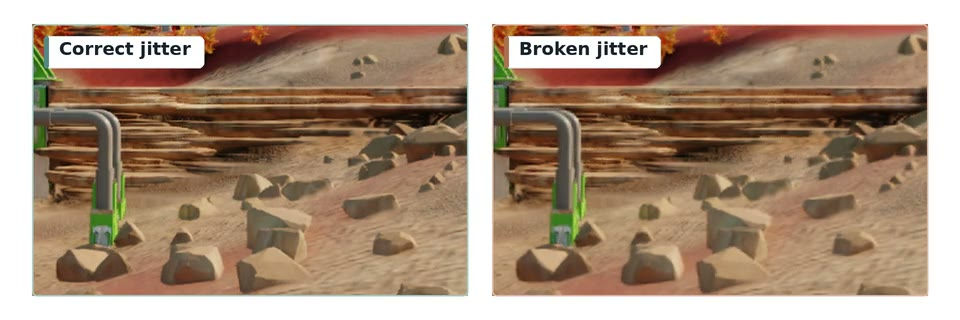](media/nss/jitter-correct-vs-broken.mp4)

[Open the jitter comparison as an MP4](media/nss/jitter-correct-vs-broken.mp4).

**Expected result:** the correctly configured side remains temporally coherent.

**Failure signature:** the invalid side shakes, flickers, or develops comb-like edge artifacts.

**Fix:** pass the actual render-space pixel sample-position offset in `jitterOffset`,
which has the opposite sign to the rasterized image displacement. Do not pass
the projection-matrix NDC adjustment directly. See the
[NSS jitter convention](NSS/NSS.md#coordinate-space).

### Poor Convergence: Jitter Sequence

**Likely causes**

- Too few unique jitter samples are used.
- The sequence is biased or does not cover the pixel evenly.
- The sequence repeats earlier than the NSS-recommended phase count.

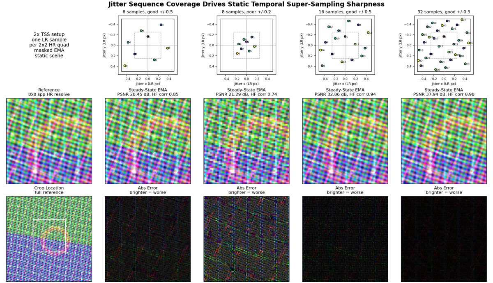

*Broader, well-distributed jitter coverage improves the quality of the accumulated result.*

Linearly resample the jittered input after removing the supplied jitter. Static content should remain aligned across the sequence:

[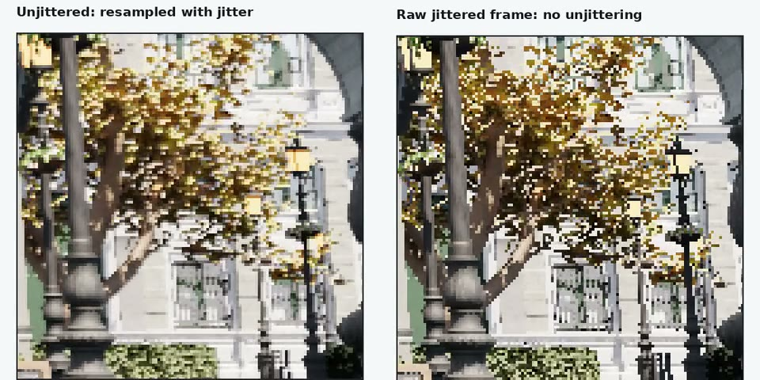](media/nss/jitter-resample-stability.mp4)

[Open the jitter stability comparison as an MP4](media/nss/jitter-resample-stability.mp4).

**Expected result:** the unjittered view remains stable while the raw jittered input moves through the sample pattern.

**Failure signature:** the unjittered view still moves, or the sequence repeatedly samples only part of the pixel.

**Fix:** select the sequence and query its recommended phase count as described in [NSS jitter sequence quality and phase count](NSS/NSS.md#jitter-sequence-quality-and-phase-count).

### Ghosting or Unstable Geometry: Motion Vectors

**Likely causes**

- Motion vectors point from the previous frame to the current frame instead of from the current frame to the previous frame.
- X or Y polarity is inverted.
- `motionVectorScale` does not convert the stored values to NSS screen-space pixel offsets.
- Vectors include camera jitter but jitter cancellation is disabled, or jitter
  is removed twice by both the application and SDK.

Warp the previous frame using the supplied motion vectors and compare it with the current frame:

For NSS, inspect `motion_vector` and `luma_instability` over several frames as well as the warped colour. Test the four X/Y polarity combinations (`+/+`, `-/+`, `+/-`, and `-/-`) if the engine convention is uncertain.

Incorrect coordinate space, direction, or scale can produce distinctive artifacts in `luma_instability`, indicating that motion-vector configuration needs correction.

[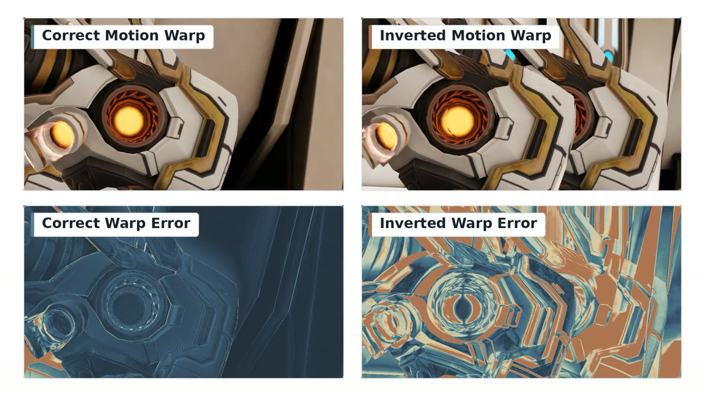](media/common/motion-vector-warp-polarity.mp4)

[Open the motion-vector warp comparison as an MP4](media/common/motion-vector-warp-polarity.mp4).

**Expected result:** moving geometry in the warped history aligns with the current frame and the error view remains dark except at disocclusions.

**Failure signature:** duplicated edges, displaced geometry, or a high-contrast reprojection error across moving objects.

**Fix:** test the four X/Y polarity combinations, then correct the vector direction and `motionVectorScale` rather than compensating elsewhere.

Use the component-specific [NSS motion-vector convention](NSS/NSS.md#space) or [NFRU prepare parameters](NFRU/NFRU.md#prepare-dispatch) when converting units; the components do not always use the same pixel dimensions. For jittered vectors, check [NSS jitter cancellation](NSS/NSS.md#jittered-motion-vectors) or [NFRU jitter cancellation](NFRU/NFRU.md#motion-vector-jitter-cancellation).

### Ghosting Around Disocclusions: Depth Convention

**Likely causes**

- `FFX_API_NSS_CONTEXT_FLAG_DEPTH_INVERTED` does not match the depth buffer.
- Near/far camera values or the infinite-depth flag do not match the projection.

[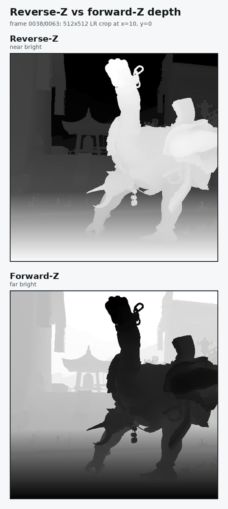](media/common/depth-convention-disocclusion.mp4)

[Open the depth-convention comparison as an MP4](media/common/depth-convention-disocclusion.mp4).

**Expected result:** the disocclusion response follows moving geometry edges.

**Failure signature:** the response becomes almost completely black or rejects large unrelated areas.

**Fix:** inspect whether near geometry is represented by larger or smaller depth values, then make the context flags and camera parameters match the actual buffer.

See [NSS depth configuration](NSS/NSS.md#providing-depth-buffer) for the flag definitions.

### Lost Detail or Ghosting: Exposure

For exposure modes and value selection, see [Providing exposure value](NSS/NSS.md#providing-exposure-value). To diagnose lost detail, inspect the tonemapped model input:

[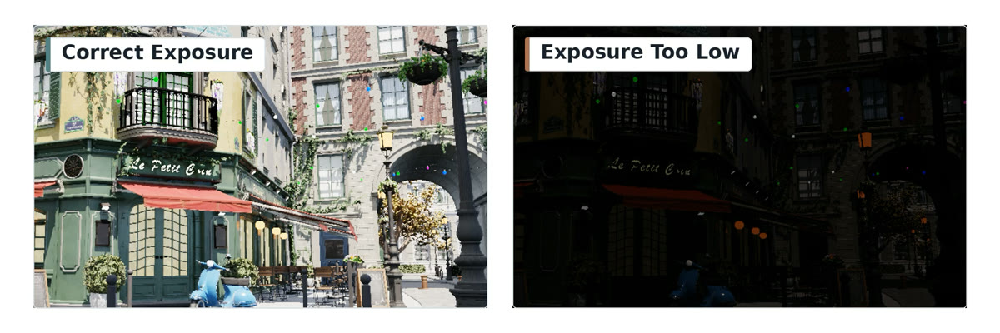](media/nss/exposure-too-low.mp4)

[Open the exposure comparison as an MP4](media/nss/exposure-too-low.mp4).

**Expected result:** important structure remains visible in the tonemapped `lr_warped_history` or `unjittered_color` debug tile.

**Failure signature:** large regions collapse toward black or white, and moving detail becomes blurred or unstable.

**Fix:** compare tonal detail in these tiles with the application's final tonemapped image, then adjust exposure according to the component guide. Test representative bright and dark scenes rather than a single frame.

### Artifact Already Present in Input Colour

NSS reconstructs the frames supplied by the application. Before changing NSS:

1. Capture the low-resolution input colour without NSS.
2. Check shadows, transparency, particles, and other temporally accumulated effects.
3. Confirm that motion blur, film grain, and other effects are placed on the intended side of NSS.

If the artifact is visible in the input, fix the producing render pass first.

## NFRU Troubleshooting

For descriptor requirements, the 3x3 debug-view layout, and presentation behavior, see the [NFRU technical documentation](NFRU/NFRU.md).

Diagnose NFRU in this order:

1. Inspect raw colour, depth, motion vectors, camera data, sizes, formats, and context flags.
2. Inspect motion-vector and optical-flow candidate frames in the 3x3 debug view.
3. Inspect disocclusion and dynamic masks.
4. Investigate learned parameters or model behavior only after the input contract passes.

### Block Artifacts: Motion-Vector Polarity or Scale

Invalid motion vectors can scatter colour into unrelated locations and produce short-lived rectangular artifacts:

[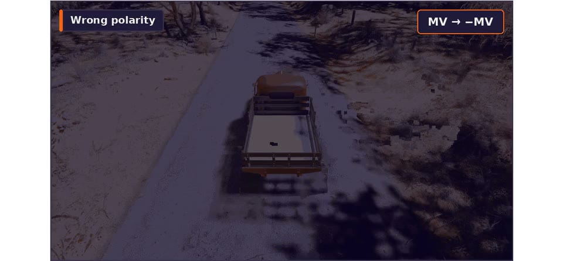](media/nfru/broken-motion-blocks.mp4)

[Open the NFRU block-artifact example as an MP4](media/nfru/broken-motion-blocks.mp4).

**Expected result:** moving objects remain coherent between rendered frames.

**Failure signature:** isolated blocks or fragments appear around moving geometry.

Use the same warp-alignment test shown in [Ghosting or Unstable Geometry: Motion Vectors](#ghosting-or-unstable-geometry-motion-vectors). Also verify that the engine has decoded packed or encoded motion-vector textures before passing them to NFRU.

### Incorrect Dynamic Mask: View-Projection Matrix

Check the captured `viewProjection` and `jitterOffset` against the [NFRU matrix contract in Prepare Dispatch](NFRU/NFRU.md#prepare-dispatch). A jittered matrix or a mismatched math/storage convention can invalidate the camera-derived motion used by the dynamic mask.

[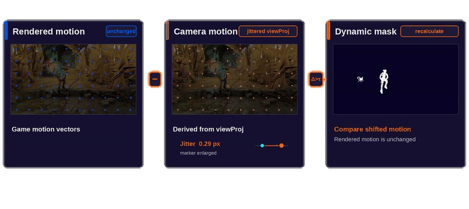](media/nfru/view-projection-dynamic-mask.mp4)

[Open the view-projection comparison as an MP4](media/nfru/view-projection-dynamic-mask.mp4).

**Expected result:** camera-derived motion agrees with rendered motion on static geometry, so the dynamic mask isolates independently moving content.

**Failure signature:** static background is marked dynamic, or valid dynamic content is missed.

**Fix:** normalize the camera data to the documented matrix contract and verify that static background no longer appears dynamic before tuning mask thresholds.

### Misaligned Candidate Frames

The NFRU debug view exposes motion-vector-warped and optical-flow-warped candidates. Compare both time directions:

[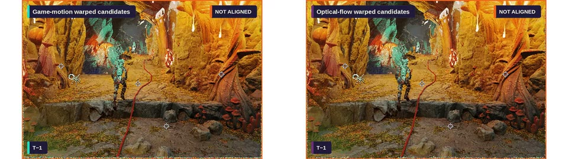](media/nfru/warp-candidate-alignment.mp4)

[Open the candidate-alignment comparison as an MP4](media/nfru/warp-candidate-alignment.mp4).

**Expected result:** the `tm1` and `tp1` candidates overlap at the target time, apart from true disocclusions.

**Failure signature:** foreground edges or the background remain offset between candidates.

For motion-vector candidates, check direction, scale, and frame pairing. For optical-flow candidates, also confirm that optical flow was computed from the same colour frames supplied to interpolation.

### Incorrect Disocclusion Regions

Inspect both depth tiles and both disocclusion-mask tiles in the 3x3 debug view:

- Depth should use the convention selected by the context flags.
- Disocclusion masks should follow newly revealed geometry, not reject most of the frame.
- Verify frame pairing, orientation, and each resource's dimensions against
  [NFRU resources](NFRU/NFRU.md#resources); do not assume that all inputs have
  the same resolution.

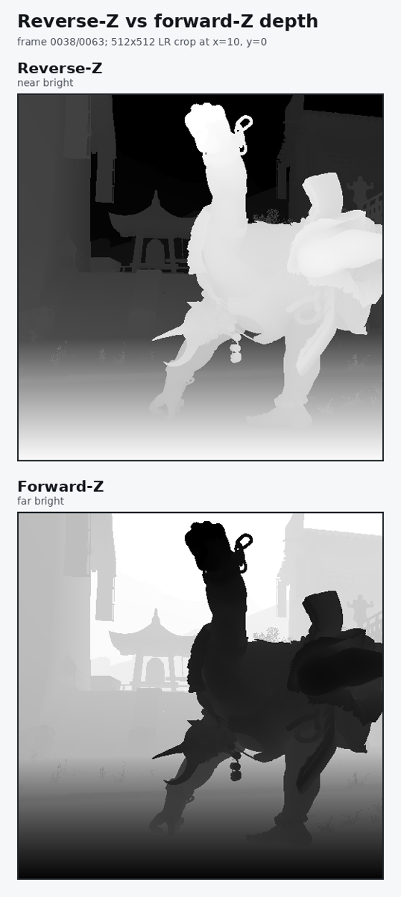

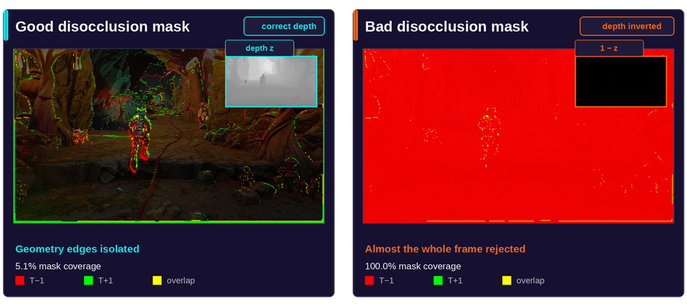

The depth-convention comparison in [Ghosting Around Disocclusions: Depth Convention](#ghosting-around-disocclusions-depth-convention) illustrates the expected difference.

### Post-Processing Moves Incorrectly

Check the render-pass ordering against [NFRU placement in the frame](NFRU/NFRU.md#placement-in-the-frame), then isolate any effect whose motion is not represented by the scene inputs.

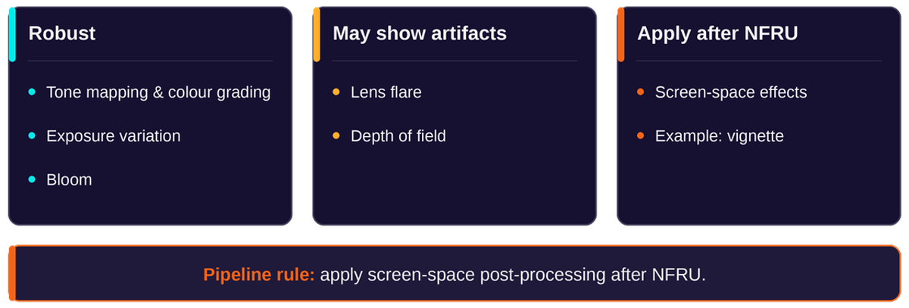

*Screen-space effects that cannot provide temporally consistent inputs should run after NFRU.*

If an effect such as lens flare, depth of field, motion blur, or another screen-space pass moves incorrectly:

1. Disable the effect and verify the base NFRU integration.
2. Check whether the effect contributes valid depth and motion.
3. Move the effect after NFRU if it cannot provide temporally consistent inputs.

### Ghosting Across a Discontinuity

Interpolation requires valid correspondence between consecutive rendered frames. Set `reset = true` on:

- Camera cuts or teleports.
- Level loads.
- Abrupt character or scene replacement.
- Any frame where the previous and current images do not describe continuous motion.

On a reset frame, NFRU copies the latest presentation colour instead of interpolating invalid history.

If reset copies appear unexpectedly, check frame IDs and history bindings against
[NFRU Prepare Dispatch](NFRU/NFRU.md#prepare-dispatch) and
[Resources](NFRU/NFRU.md#resources). Follow
[Presentation Pacing](NFRU/NFRU.md#presentation-pacing) when handling reset
duplicates; they are not distinct interpolated samples.

## Escalation Checklist

Before treating the issue as a model-quality problem, record:

- A short reproducible frame range with individual input and output frames.
- Context flags, render/display sizes, formats, and camera parameters.
- The jitter values, motion-vector scale, and frame IDs for the captured range.
- Raw colour, depth, and motion-vector inputs.
- NSS 4x4 or NFRU 3x3 debug-view output.
- The result of the motion-warp alignment test.
- Whether the issue persists with post-processing disabled and correct reset handling.

Escalate only after these checks show that the integration contract is satisfied.
