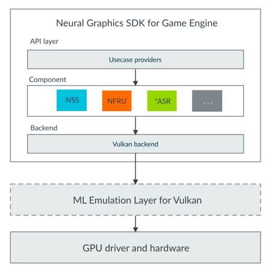
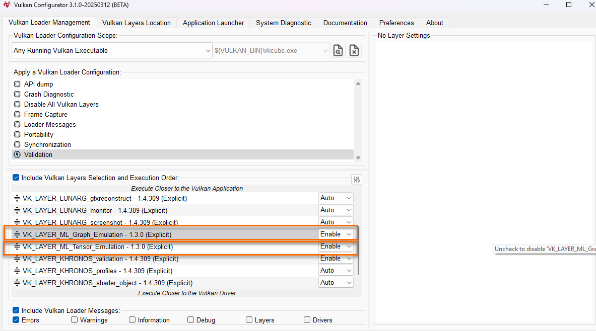

# Arm&reg; Neural Graphics SDK for Game Engines Developer Guide

This document is Non-Confidential.
Copyright &copy; 2025–2026 Arm Limited.

This document is licensed under the Creative Commons Attribution-NoDerivatives 4.0 International License. A copy of the license is available at: https://creativecommons.org/licenses/by-nd/4.0/.

The license permits copying and redistribution of the document, but does not permit adapted versions to be shared, in each case, subject to the terms of the license.

Except for the rights expressly granted under that license, Arm reserves all rights in this document.

The use or implementation of the information contained in this document may be protected by one or more patents or pending patent applications.

The Arm corporate logo and words marked with &reg; or &trade; are registered trademarks or trademarks of Arm Limited or its affiliates in the United States and/or elsewhere. Other brands and names mentioned in this document may be trademarks of their respective owners.
The Creative Commons license does not grant any patent or trademark rights, including permission to use Arm’s trademarks or logos separately from this document or in any manner that suggests that Arm sponsors, endorses or is associated with any person, product or service. This does not prevent Arm’s trademarks or logos from being reproduced as they appear within a copy or extract of the document permitted under the license. References in this document to third-party products or services do not constitute Arm’s approval or endorsement of them.

For guidance on the use of Arm’s trademarks and logos, see Arm’s trademark usage guidelines at https://www.arm.com/company/policies/trademarks.

The content of this document is provided for informational purposes only and is based on information available as at its date of issue. The information, products and solutions described in this document may change without notice, and this document may contain technical inaccuracies or typographical errors.

Users are responsible for compliance with all applicable export control and sanctions laws and regulations.

See also: [Useful resources](#useful-resources)

# Table of contents

- [Arm® Neural Graphics SDK for Game Engines Developer Guide](#arm-neural-graphics-sdk-for-game-engines-developer-guide)
- [Table of contents](#table-of-contents)
- [Introduction](#introduction)
- [Before you begin](#before-you-begin)
- [Project layout](#project-layout)
- [Build the SDK](#build-the-sdk)
  - [Native builds](#native-builds)
  - [Docker builds](#docker-builds)
- [Integrate the SDK](#integrate-the-sdk)
  - [Add the SDK to your project](#add-the-sdk-to-your-project)
  - [Include headers](#include-headers)
  - [Core API](#core-api)
  - [Enable Vulkan extensions](#enable-vulkan-extensions)
  - [Resources and resource states](#resources-and-resource-states)
  - [Create, dispatch, reset, and destroy a context](#create-dispatch-reset-and-destroy-a-context)
    - [Synchronization and context lifecycle](#synchronization-and-context-lifecycle)
  - [Diagnostics and memory](#diagnostics-and-memory)
- [ML Emulation Layer for Vulkan](#ml-emulation-layer-for-vulkan)
    - [Download the emulation layer](#download-the-emulation-layer)
  - [Vulkan Configurator](#vulkan-configurator)
  - [Environment variables](#environment-variables)
- [Verify your integration](#verify-your-integration)
- [Detailed technical documentation](#detailed-technical-documentation)
- [Useful resources](#useful-resources)

# Introduction

The Arm&reg; Neural Graphics Software Development Kit (SDK) is a Vulkan-based, engine-agnostic framework for neural rendering in game engines. It derives from AMD FidelityFX SDK 1.1.3 and supports:

- **Neural Super Sampling (NSS)** for temporal super resolution.
- **Neural Frame Rate Upscaling (NFRU)** for frame interpolation.

Follow this guide in order to build and complete a first SDK integration, including API behavior, resource states, synchronization, context lifecycle, diagnostics, and memory queries shared by NSS and NFRU. The [NSS](NSS/NSS.md) and [NFRU](NFRU/NFRU.md) guides provide component-specific descriptors and resource contracts. The [integration troubleshooting guide](integration_troubleshooting.md) provides a symptom-oriented validation flow with visual examples.



# Before you begin

Install the following before building. For supported and recommended tool
versions, see [Build Tool Versions](compatibility_matrix.md#build-tool-versions).

| Tool | Purpose |
|-------------|--------------------|
| Git | Clone the repository and initialize submodules. |
| Git LFS | Install [Git Large File Storage](https://git-lfs.com/) to download the binary dependencies stored in Git LFS. |
| Python | Run `build.py`. |
| CMake | Configure and build the SDK. |
| Ninja | Build the SDK on Linux and Android. |
| Vulkan SDK | Provide Vulkan headers and shader build tools. |
| Android NDK | Build for native Android AArch64; set `ANDROID_NDK` or `NDK_ROOT`. |

The build script provides Windows x64, Linux x64, Linux AArch64, and Android AArch64 targets. Build-target availability is not a guarantee of device or driver compatibility; check the [compatibility matrix](compatibility_matrix.md). Integration requires familiarity with Vulkan device creation, command buffers, resource states, and synchronization.

After installing Git LFS, initialize it, clone the repository, and fetch all
submodules and LFS binary payloads:

```bash
git lfs install
git clone https://github.com/arm/neural-graphics-sdk-for-game-engines.git
cd neural-graphics-sdk-for-game-engines
git submodule update --init --recursive
git lfs pull
git submodule foreach --recursive git lfs pull
```

# Project layout

| Path | Purpose |
|------|---------|
| `ffx-api/include/ffx_api/` | Public C and C++ API headers, component descriptors, and Vulkan backend descriptor. |
| `sdk/include/FidelityFX/` | SDK host and GPU headers. |
| `sdk/src/backends/vk/` | Vulkan backend implementation and data graphs. |
| `sdk/src/components/` | NSS, frame interpolation, and optical-flow implementations. |
| `samples/` | NSS and NFRU sample applications. |
| `docs/` | User and component documentation. |
| `bin/` | Build output, including libraries and optional Vulkan layer artifacts. |

# Build the SDK

Inspect all supported targets and options before selecting a build:

```bash
python build.py -h
```

Successful builds place SDK libraries and Vulkan layer artifacts in `bin/`. `build.py` selects shared SDK libraries by default; `--build-samples` selects static libraries and cannot be combined with `-DFFX_BUILD_AS_DLL=ON`. Direct CMake builds default to static libraries. Reuse of a build directory retains cached options; use `--clean` when changing configuration and verify the effective CMake settings.

Release builds omit debug information from SDK and NG layer libraries and
remove the checkout prefix from embedded source paths. Use Debug or
RelWithDebInfo when source-level debugging is required.

## Native builds

Run one command from the repository root:

| Target platform | Command |
|-----------------|---------|
| Windows x64 release | `python build.py -t Release -b vk_windows_x64` |
| Windows x64 debug | `python build.py -t Debug -b vk_windows_x64` |
| Linux x64 release | `python build.py -t Release -b vk_linux_x64` |
| Linux Arm64 release | `python build.py -t Release -b vk_linux_arm --vulkan-lib=path/to/vulkan/lib/for/aarch64` |
| Android Arm64 release | `python build.py -t Release -b vk_android_arm` |
| Android Arm64 debug | `python build.py -t Debug -b vk_android_arm --android-api 33` |

For Linux AArch64, `--vulkan-lib` is forwarded to `CMAKE_PREFIX_PATH`: provide an AArch64 Vulkan installation directory containing the headers and libraries.

For supported sample targets, fetch the sample dependencies before adding `--build-samples`. The [sample guide](../samples/README.md) explains platform prerequisites, Android APK restrictions, dependency setup, and execution.

`FFX_DEBUG` enables debug-only backend and component paths. It defaults to `ON` for Debug builds and `OFF` for Release and RelWithDebInfo builds. Override it when necessary:

```bash
python build.py -t Debug -b vk_linux_x64 --build-samples --cmake-args="-DFFX_DEBUG=OFF"
```

## Docker builds

Docker supports Linux x64, Linux Arm64, and Android Arm64 targets:

```bash
# Linux x64
python build.py --docker -t Release -b vk_linux_x64

# Linux Arm64
python build.py --docker -t Release -b vk_linux_arm

# Android Arm64
python build.py --docker -t Debug -b vk_android_arm --android-api 33
```

Use `--docker-rebuild` to rebuild the default `ngsdk-build:latest` image. Windows x64 is native-only.

You can also skip building the SDK and use the supplied prebuilt libraries in
`prebuilt_binaries/`.

# Integrate the SDK

## Add the SDK to your project

Choose one integration method:

1. **Build from source:** copy the SDK into your project and add it as a CMake subproject:

    ```cmake
    set(FFX_API_BACKEND vk_linux_x64 CACHE STRING "SDK backend")
    add_subdirectory(path/to/ngsdk)
    target_link_libraries(MyGame PRIVATE ngsdk_linux_x64)
    ```

    Select the backend for your target before configuring CMake. The library target is `ngsdk_<os>_<arch>`, for example `ngsdk_windows_x64` or `ngsdk_android_arm`. The target exports `ffx-api/include`; supply compatible Vulkan headers to the application as well.

2. **Use prebuilt libraries:** link the target-platform library from `prebuilt_binaries/` and add `ffx-api/include` and compatible Vulkan headers to your include path. Deploy shared libraries with the application; static integration also needs the component and backend dependencies. See the [NSS guide](NSS/NSS.md) and [NFRU guide](NFRU/NFRU.md) for component-specific runtime asset requirements.

## Include headers

Define `FFX_CPU` before including any SDK header:

```cpp
#define FFX_CPU
#include <ffx_api/ffx_api.hpp>
#include <ffx_api/ffx_api_types.h>
#include <ffx_api/vk/ffx_api_vk.hpp>

// Include only the component headers that your application uses.
#include <ffx_api/ffx_nss.hpp>
#include <ffx_api/ffx_framegeneration.hpp>
```

## Core API

| Function | Purpose |
|----------|---------|
| `ffxCreateContext` | Creates an NSS or NFRU context from a component descriptor and backend descriptor. You need to keep descriptor pointers valid until context destruction. |
| `ffxDestroyContext` | Frees context resources. You need to wait for all GPU work using the context to finish first. |
| `ffxDispatch` | Records the component's GPU work for the current frame. |
| `ffxQuery` | Queries supported information such as NSS jitter, provider versions, capture status, GPU memory, or build-gated CPU heap data. |
| `ffxConfigure` | Changes supported runtime configuration, such as an NFRU debug view. |

The API returns `ffx::ReturnCode`. You need to treat any result other than `ffx::ReturnCode::Ok` as an error and report it through the message callback supplied during context creation. Component-specific creation, dispatch, query, and configuration descriptors can be found in the [NSS guide](NSS/NSS.md), [NFRU guide](NFRU/NFRU.md), and [dataset capture guide](Capture/Capture.md).

## Enable Vulkan extensions

Enable the extensions required by the component during `VkDevice` creation:

| Extension | NSS | NFRU |
|-----------|:---:|:----:|
| `VK_KHR_synchronization2` | Required | Required |
| `VK_ARM_tensors` | Required | Required |
| `VK_ARM_data_graph` | Required | Required |
| `VK_ARM_data_graph_optical_flow` | - | Required |

You can enable the Arm ML extensions in either of the following ways:

1. **Use `VK_LAYER_ARM_NG`:** a source build places its binary and manifest in
   `bin/`. A prebuilt bundle provides a self-contained directory under
   `prebuilt_binaries/layers/`: `windows_x64/`, `linux_x64/`, or
   `android_arm64/`. Keep the selected manifest beside its matching library.
   On desktop, set `VK_ADD_LAYER_PATH` to that platform directory (or `bin/`
   for a source build) and add `VK_LAYER_ARM_NG` to `VK_INSTANCE_LAYERS`.
   On Android, package `libVkLayer_arm_NG_android.so` from the Android layer
   directory in your application module's `src/main/jniLibs/arm64-v8a/`
   directory. Confirm that `vkEnumerateInstanceLayerProperties` lists
   `VK_LAYER_ARM_NG`, then include it in
   `VkInstanceCreateInfo::ppEnabledLayerNames` and update `enabledLayerCount`
   before calling `vkCreateInstance`. Android discovers the packaged layer SO;
   it does not use the desktop JSON manifest or `VK_ADD_LAYER_PATH` mechanism.
   See the [Android Vulkan layer setup](https://developer.android.com/ndk/guides/graphics/validation-layer#prebuilt-binaries)
   for APK packaging and layer enablement.
   Subject to device
   support and injection conditions, the layer adds Arm ML extensions, feature
   structures, and dependency extensions. It does not provide missing device
   capabilities or override application-provided Arm feature structures.
   See the [layer guide](../layer/README.md) for its gates and mutation of
   application-provided synchronization2 structures.
2. **Enable extensions in code:** enumerate extension support, enable the required extension names and their dependencies, then enable the required feature bits in the `pNext` chain. Synchronization2 is core in Vulkan 1.3, so its extension name is needed only when using the extension path; its feature must still be enabled.

The following partial pattern checks the component features. It assumes that the application has already selected a Vulkan 1.3 device, enumerated supported extension names, added the data-graph dependencies (`VK_KHR_deferred_host_operations` and either `VK_KHR_maintenance5` or `VK_KHR_extended_flags`) to `applicationExtensions`, and prepared valid queue creation information. Preserve the application's other feature structures. Set `requiresNativeTensorAccess` according to the selected shader path: native access requires `shaderTensorAccess` and suitable `shaderTensorSupportedStages`; buffer-alias paths instead have storage-feature requirements described in the [compatibility matrix](compatibility_matrix.md#device-features). Include optical flow only when creating an NFRU context:

```cpp
std::vector<const char*> extensions = applicationExtensions;
extensions.push_back(VK_ARM_TENSORS_EXTENSION_NAME);
extensions.push_back(VK_ARM_DATA_GRAPH_EXTENSION_NAME);

if (usingNfru) {
    extensions.push_back(VK_ARM_DATA_GRAPH_OPTICAL_FLOW_EXTENSION_NAME);
}

VkPhysicalDeviceSynchronization2FeaturesKHR synchronization2{
    VK_STRUCTURE_TYPE_PHYSICAL_DEVICE_SYNCHRONIZATION_2_FEATURES_KHR};
VkPhysicalDeviceTensorFeaturesARM tensor{
    VK_STRUCTURE_TYPE_PHYSICAL_DEVICE_TENSOR_FEATURES_ARM};
VkPhysicalDeviceDataGraphFeaturesARM dataGraph{
    VK_STRUCTURE_TYPE_PHYSICAL_DEVICE_DATA_GRAPH_FEATURES_ARM};
VkPhysicalDeviceDataGraphOpticalFlowFeaturesARM opticalFlow{
    VK_STRUCTURE_TYPE_PHYSICAL_DEVICE_DATA_GRAPH_OPTICAL_FLOW_FEATURES_ARM};

VkPhysicalDeviceFeatures2 supported{VK_STRUCTURE_TYPE_PHYSICAL_DEVICE_FEATURES_2};
supported.pNext = &synchronization2;
synchronization2.pNext = &tensor;
tensor.pNext = &dataGraph;
if (usingNfru) {
    dataGraph.pNext = &opticalFlow;
}
vkGetPhysicalDeviceFeatures2(physicalDevice, &supported);

VkDeviceCreateInfo deviceCreateInfo{VK_STRUCTURE_TYPE_DEVICE_CREATE_INFO};
deviceCreateInfo.enabledExtensionCount = static_cast<uint32_t>(extensions.size());
deviceCreateInfo.ppEnabledExtensionNames = extensions.data();
deviceCreateInfo.pNext = &synchronization2;

VkDevice device = VK_NULL_HANDLE;
VkResult result = vkCreateDevice(physicalDevice, &deviceCreateInfo, nullptr, &device);
if (result != VK_SUCCESS) {
    // Handle unsupported extensions or an invalid feature configuration.
}
```

Do not treat the above example code as a complete device initializer: merge the dependency names and other required features into the application's configuration before `vkCreateDevice`. NSS and NFRU also have shader-path feature requirements; use the [NSS guide](NSS/NSS.md), [NFRU guide](NFRU/NFRU.md), and [compatibility matrix](compatibility_matrix.md#vulkan-runtime-requirements) to select a supported path.

## Resources and resource states

Every texture or buffer passed to the SDK is represented by an `FfxApiResource` with a native resource handle, description, and current `state`. You need to set the `state` field to the resource's actual Vulkan state when the recorded commands execute. The SDK uses this value as the starting point for barriers between its own passes.

Resource descriptions must match the native allocation's format,
dimensions, mip count, and usage. These are borrowed resources: the SDK does
not take ownership of their images, buffers, or memory. Null resources are
valid only for fields documented as optional.

| Resource role | Compute-only path | Fragment-only path | Mixed fragment/compute path |
|---------------|-------------------|-------------------|-----------------------------|
| Inputs and history such as `color`, `depth`, `motionVectors`, and `outputTm1` | `FFX_API_RESOURCE_STATE_COMPUTE_READ` | `FFX_API_RESOURCE_STATE_PIXEL_READ` | `FFX_API_RESOURCE_STATE_PIXEL_COMPUTE_READ` when read by both stages |
| Outputs such as `output` and `debugViews` | `FFX_API_RESOURCE_STATE_UNORDERED_ACCESS` | `FFX_API_RESOURCE_STATE_RENDER_TARGET` | Use the state for the stage that writes each output |

NFRU's `ALL_STAGES_COMPUTE` flag selects compute only for selectable stages; fixed downsample passes can remain fragment jobs according to the resolution plan. Inputs read by both those fragment passes and compute passes therefore need `FFX_API_RESOURCE_STATE_PIXEL_COMPUTE_READ`, even when all selectable stages are set to compute. The NFRU sample uses this combined input state.

For tile-based GPUs, you could prefer eligible fragment paths and render-target outputs. Unnecessary storage-image usage can disable Arm Frame Buffer Compression (AFBC) and increase bandwidth. The component guides provide the required formats, resolutions, coordinate systems, and field-specific state rules.

## Create, dispatch, reset, and destroy a context

Follow this lifecycle for the component you selected:

1. Create an `ffx::CreateBackendVKDesc` from the Vulkan instance, physical device, device, and function pointers.
2. Create the component descriptor: `ffx::CreateContextDescNss` for NSS or `ffx::CreateContextDescFrameGeneration` for NFRU.
3. Call `ffx::CreateContext`.
4. Every frame, populate the component dispatch descriptor with resources in their current Vulkan states, then call `ffx::Dispatch`.
5. Set the dispatch `reset` field after camera cuts, teleports, level loads, or another temporal discontinuity.
6. Wait for GPU work that uses the context to finish, then call `ffx::DestroyContext`.

NFRU requires a prepare dispatch followed by a frame-generation dispatch using the same strictly increasing frame ID, with presentation pacing owned by the application. The [NFRU guide](NFRU/NFRU.md) provides the complete sequence. The [NSS guide](NSS/NSS.md) provides the required jitter, history, motion-vector, and resource configuration.

### Synchronization and context lifecycle

The SDK records commands into the `VkCommandBuffer` provided at dispatch and inserts barriers only between its own passes. You need to transition resources to the state declared in each `FfxApiResource` and synchronize SDK work with application rendering and presentation using Vulkan semaphores or fences. As described in the lifecycle above, wait for GPU completion before destroying a context.

You need to recreate a context when its maximum render or display resolution, or its creation flags, change.

**Context thread affinity:** Each `ffxContext` instance, including NSS and frame-generation contexts, must be used serially by its owning thread. Calls that operate on the same context, including dispatch, query, configure, and destroy, must not overlap across threads. Different contexts may be used concurrently from different threads, including when they share the same Vulkan device.

## Diagnostics and memory

SDK diagnostics use stderr, or Android Logcat with tag `FFX`. `FFX_SDK_LOG_LEVEL` defaults to `warn`; set it to `info` before the first SDK call for informational records. On Android, the `debug.arm.logging.level` system property takes precedence over `FFX_SDK_LOG_LEVEL` because Android integrations use system properties as their supported runtime configuration channel. The optional `fpMessage` callback is independent of this sink filter. See [NSS runtime logging](NSS/NSS.md#runtime-logging) and [NFRU runtime logging](NFRU/NFRU.md#runtime-logging) for per-frame logs and CPU timings.

The component-specific GPU-memory and CPU-heap query descriptors are available after context creation or a successful dispatch. You could use the GPU-memory descriptors after a successful dispatch to query current-frame allocations. The reported GPU-memory values include resources tracked by the effect and backend, but exclude application-owned resources, swapchain allocations, and driver residency. The CPU-heap query reports current and peak CPU heap allocations owned by the effect context. More details can be found in the [NSS queries](NSS/NSS.md#ffxquery) and [NFRU queries](NFRU/NFRU.md#ffxquery).

# ML Emulation Layer for Vulkan

Use the Arm Vulkan ML Emulation Layer when the target device does not natively support `VK_ARM_tensors` and `VK_ARM_data_graph`.

## Download the emulation layer

The repository provides a script that downloads the compatible emulation-layer release from the version listed in [`docs/compatibility_matrix.md`](compatibility_matrix.md) and extracts it under `deps/emulation_layer/`. Run it from the repository root:

```bash
python scripts/download_emulation_layer.py
```

The script detects the host platform automatically. Use the `--platform` option when needed, for example `--platform Windows_AMD64` or `--platform Linux_x86_64`. A manually downloaded compatible package remains supported; in that case, use its installation directory in the environment variables below.

Always put `VK_LAYER_ML_Graph_Emulation` before `VK_LAYER_ML_Tensor_Emulation`. If you also use `VK_LAYER_ARM_NG`, put it before both emulation layers.

## Vulkan Configurator

1. Open the **Vulkan Configurator** included with the Vulkan SDK.
2. Find **VK_LAYER_ML_Graph_Emulation** and select **Enable**.
3. Find **VK_LAYER_ML_Tensor_Emulation** and select **Enable**.
4. If you use `VK_LAYER_ARM_NG`, enable it and place it first in the layer order.



## Environment variables

Set the library and layer paths before starting your application.

On Windows:

```powershell
$emulationLayer = (Resolve-Path "deps\emulation_layer\Windows_AMD64").Path
$env:VK_ADD_LAYER_PATH = "$emulationLayer\bin;$emulationLayer\share\vulkan\explicit_layer.d"
$env:PATH = "$emulationLayer\bin;$env:PATH"
$env:VK_INSTANCE_LAYERS = "VK_LAYER_ML_Graph_Emulation;VK_LAYER_ML_Tensor_Emulation"
```

If you also use `VK_LAYER_ARM_NG`, add the SDK `bin` directory to `VK_ADD_LAYER_PATH` and put `VK_LAYER_ARM_NG` first:

```powershell
$env:VK_ADD_LAYER_PATH = "$PWD\bin;$env:VK_ADD_LAYER_PATH"
$env:VK_INSTANCE_LAYERS = "VK_LAYER_ARM_NG;VK_LAYER_ML_Graph_Emulation;VK_LAYER_ML_Tensor_Emulation"
```

On Linux:

```bash
emulation_layer="$(pwd)/deps/emulation_layer/Linux_x86_64"
export VK_ADD_LAYER_PATH="$emulation_layer/lib:$emulation_layer/share/vulkan/explicit_layer.d"
export LD_LIBRARY_PATH="$emulation_layer/lib:${LD_LIBRARY_PATH}"
export VK_INSTANCE_LAYERS="VK_LAYER_ML_Graph_Emulation:VK_LAYER_ML_Tensor_Emulation"
```

If you also use `VK_LAYER_ARM_NG`, prepend the SDK `bin` directory to `VK_ADD_LAYER_PATH` and put `VK_LAYER_ARM_NG` first:

```bash
export VK_ADD_LAYER_PATH="$(pwd)/bin:$VK_ADD_LAYER_PATH"
export VK_INSTANCE_LAYERS="VK_LAYER_ARM_NG:VK_LAYER_ML_Graph_Emulation:VK_LAYER_ML_Tensor_Emulation"
```

# Verify your integration

1. Build and run one of the [SDK samples](../samples/README.md) on the target platform.
2. Confirm that the Vulkan validation layers report no resource-state or synchronization errors.
3. Create the component context and check its return code before dispatching.
4. Start with the component guide's recommended resource formats and integration checklist.
5. Enable the component debug view when diagnosing input, jitter, motion-vector, or interpolation problems, then follow the [integration troubleshooting guide](integration_troubleshooting.md).

# Detailed technical documentation

- [SDK README](../README.md) - component overview, documentation index, related links, and limitations.
- [NSS technical documentation](NSS/NSS.md) - NSS context flags, input resources, jitter, motion vectors, dispatch, and known issues.
- [NFRU technical documentation](NFRU/NFRU.md) - NFRU context flags, prepare/dispatch, resource coordinate systems, and pacing.
- [NSS and NFRU integration troubleshooting](integration_troubleshooting.md) - symptom index, input validation workflow, debug-view interpretation, and visual examples.
- [Sample documentation](../samples/README.md) - sample dependencies, build, run, command-line options, and UI controls.

# Useful resources

This document contains information that is specific to this product. See the following resources for other useful information.

Arm documents are available on developer.arm.com/documentation.

Confidential documents are only available to licensees, when logged in. Each document link in the following tables provides direct access to the online version of the document.

Table: Useful resources

| Arm product resources                                                                                                     | Document ID              | Confidentiality  |
| ------------------------------------------------------------------------------------------------------------------------- | ------------------------ | ---------------- |
| [Arm&reg; Moving Mobile Graphics](https://developer.arm.com/community/arm-community-blogs/b/mobile-graphics-and-gaming-blog/posts/moving-mobile-graphics) | Moving Mobile Graphics   | Non-Confidential |
